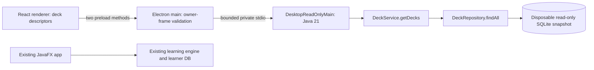

# Existing ownership and migration boundaries

Audited baseline: main `bc11a7a65b913907f9ea610074cf2ecfef23cf98`, including #240, #242 and #254. Draft #255 is a separate unmerged native redesign; none of its changes are the foundation of this proof. This inventory describes actual code. Future boundaries below are proposals for #261, not implemented migrations.

There is no edge between the experimental renderer/sidecar and the existing learner DB. `DatabaseConfig` is process-global, so the proof has its own JVM and never switches database URLs inside a running JavaFX instance.

| Responsibility | Confirmed owner and coupling | Migration constraint / next boundary |
| --- | --- | --- |
| Startup/shutdown | [`CodeFitApplication`](../../../src/main/java/com/codefit/CodeFitApplication.java) initializes SQLite, starts evidence backfill, loads navigation, and drains runner/import/player/P2P work on exit. `CodeFitLauncher` preserves JavaFX startup. | Do not launch the JavaFX application to obtain a headless API. A later sidecar must deliberately own and stop the same workers; Gate 0 starts none of them. |
| Shell/routes/thread dispatch | [`NavigationService`](../../../src/main/java/com/codefit/ui/NavigationService.java), `AppShellController`, FXML controllers, `PlayerTasks` use JavaFX scenes, tasks, navigation guards and generation checks. | Replace presentation gradually; preserve close/leave/save guards and stale-result suppression. Controllers contain orchestration, not just styling. |
| DB/migrations/transactions | [`DatabaseConfig`](../../../src/main/java/com/codefit/config/DatabaseConfig.java), `SchemaMigrator`, [`Transactions`](../../../src/main/java/com/codefit/service/Transactions.java); repositories open configured SQLite connections. Schema 25 at baseline. | Java remains sole owner. `initialize()` writes/seeds/migrates; never treat it as a read. No new migration here. Future writable sidecar needs profile ownership/locking, backups and compatibility. |
| Chosen read | [`DeckService.getDecks()`](../../../src/main/java/com/codefit/service/DeckService.java) → [`DeckRepository.findAll()`](../../../src/main/java/com/codefit/repository/DeckRepository.java), ordered by name. Constructors also create service/repository objects without starting workers. | Return only id/name/description; do not serialize the domain object or expose card contents. Java-created snapshot is reopened read-only before the first request. |
| Review/spacing/legacy mastery | `ReviewService`, `FlashcardService`, `MasteryService`, assessment services and their repositories remain Java-owned. Service/repository/evolution packages have no direct `javafx.*` imports in this baseline. | Headless-friendly implementations do not imply read-only behavior. Preserve grading, schedules, timestamps and existing legacy uncertainty. Never equate activity with Evolution mastery. |
| Assessments/import/curriculum | `AssessmentAttemptService`, `AssessmentGradingService`, `WeeklyAssessmentSelectionService`, `ProblemLibraryService` and workbook importers enforce source/cohort rules. | Reuse exact filtering and validators. No generic renderer query/search endpoint capable of exposing reserved assessments. No change to ordering or source attribution. |
| Skill/evidence/mastery/adaptation | `SkillCatalogRepository`, `EvidenceRepository`, `MasteryEstimateService`, `OrdinalMasteryPolicy`, `AdaptiveQuestService`; contracts under `evolution/`. | Preserve exact versions, evidence eligibility, epochs, UTC as-of and correlation. Do not duplicate any policy in TypeScript. |
| Player projection / rewards | [`PlayerSystemService.overview()`](../../../src/main/java/com/codefit/evolution/player/PlayerSystemService.java) calls recommendations and reward reconciliation. `DailyQuestService.getActiveQuest()` may create a quest. `ProgressionService` owns entitlements. | These are **not pure reads** despite their names. Gate 0 deliberately avoids them. Gate 2 must distinguish projections from deliberate commands and reconciliation. |
| Exposure before content | [`ChallengePresentationService`](../../../src/main/java/com/codefit/service/ChallengePresentationService.java), `ChallengeExposureRepository`, `QuestCatalogRepository` authorize/resume and persist exposure before a `View` is returned. `PlayerSystemService.work()` consumes the committed view. | A future IPC command must call this service before returning prompts/assets. Catalog IDs are not permission to retrieve content. Gate 0 has no challenge method or asset route. |
| Editable drafts | [`JavaSolutionWorkspaceService`](../../../src/main/java/com/codefit/service/JavaSolutionWorkspaceService.java), `JavaSolutionDraftRepository`, `ProblemSolvingSessionRepository`; workspace controller debounces saves. `EvolutionController` tracks dirty state, authorized `Work`, async generations and navigation disposal. | Keep original draft/session stores. Future autosave needs explicit acknowledgment and window-close coordination; no renderer-only durability promise. |
| Frozen submissions/recovery | `ChallengeEvaluationCoordinator`, [`DurableEvaluationRepository`](../../../src/main/java/com/codefit/evolution/evaluation/DurableEvaluationRepository.java), presentation context and existing attempt/evidence aliases. Existing `EvolutionController` separates saved feedback from editor state. | Preserve staged lifecycle and atomic finalization. Status/recovery must work without opening reserved content. Never infer submission completion from a lost IPC response or auto-replay mutations. |
| Java compile/run | `JavaCodeRunner`, [`JavaExecutionCoordinator`](../../../src/main/java/com/codefit/service/JavaExecutionCoordinator.java), `CompileOutcomeRegistry`, cancellation tokens and bounded evaluator checks. | Keep process limits/serialization and trusted harness semantics. The runner is not a security sandbox. No compiler/runner endpoint in Gate 0; its jlink runtime is read-only-use-case scoped. |
| P2P | [`PeerSessionHolder`](../../../src/main/java/com/codefit/ui/PeerSessionHolder.java) owns one application-lifetime networking service/presenter/dial gate. `NetworkingService`, identity/consent/protocol repositories and `ProgressSnapshotService` own transport and allowed aggregates. | Screen disposal must not accidentally reset network identity or live sessions. Gate 0 never starts P2P, reads secrets, or exports shared aggregates. Later frontend must reuse consent and signatures, not invent network messages. |

## Minimum Gate 0 change

Add a separate entrypoint, strict JSON streaming dependency and dedicated test files; all existing JavaFX controllers, application startup, database configuration, migrations, business services and isolation controls stay unchanged. Reuse the whole compiled engine for the spike rather than splitting Maven modules prematurely. This increases package size; a later measured headless module extraction is preferable to blindly deleting runtime dependencies.

## Principal transition risks

1. A read-shaped method performs writes: audit use cases individually before IPC publication.
2. Two JVMs open one mutable profile: future exclusive ownership/compatibility rules must precede writable integration.
3. Navigation destroys unsaved edits or hides recoverable submissions: preserve application-service semantics and controller regression cases during Gate 3.
4. Renderer access turns reserved catalog assets into generic file URLs: explicit Java authorization, DTO projection and resource allowlisting must remain mandatory.
5. A packaged JRE loses compiler/native dependencies: build and validate native runtime variants before runner migration.
6. P2P lifecycle is mistaken for screen state: retain Java service ownership and existing privacy aggregates.

Rollback at this gate requires only closing/removing the proof. No learner data, migration or JavaFX changes need reversal.
