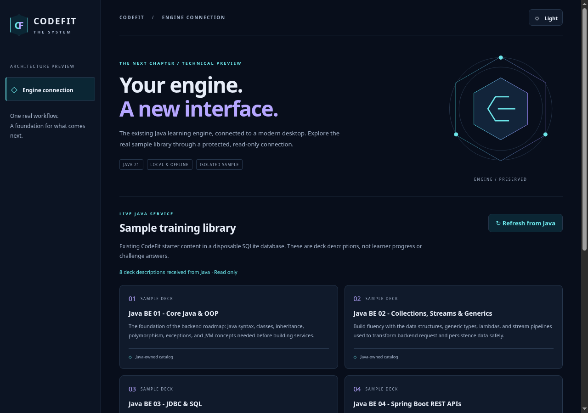
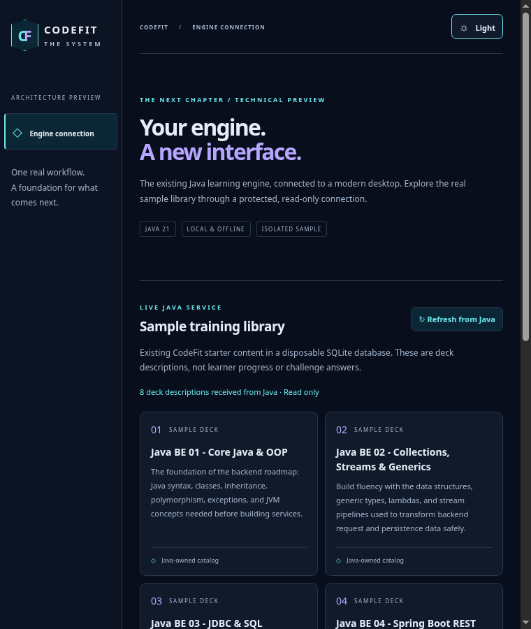
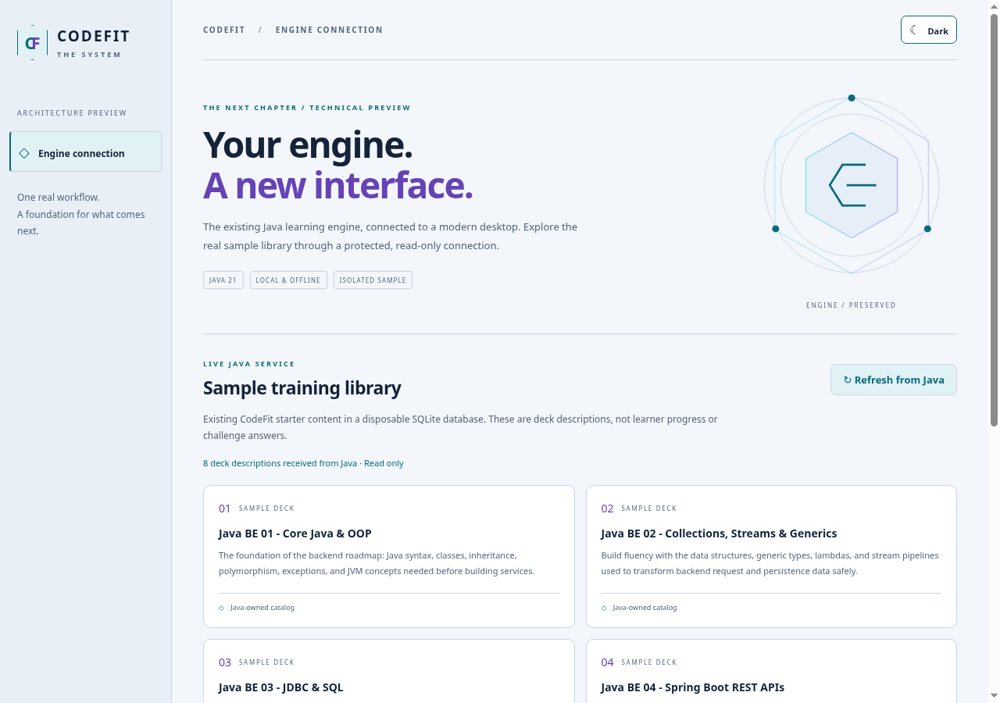
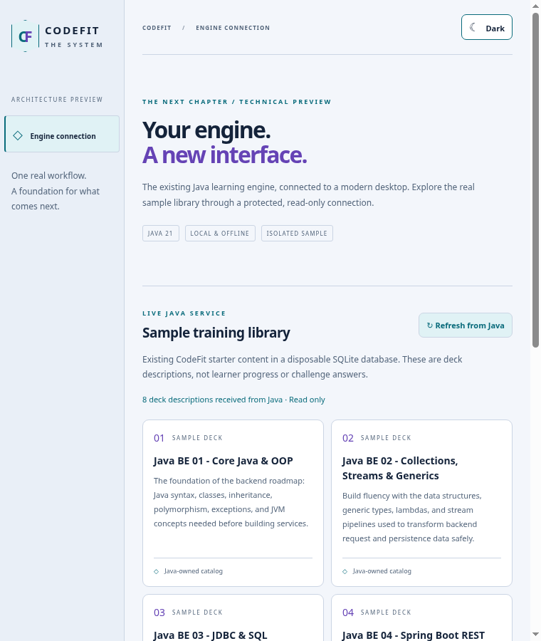

# Gate 0 verification record

Scope: #257 / #256 only. Based on main `bc11a7a65b913907f9ea610074cf2ecfef23cf98`; draft #255 remains unmerged and unapproved. JavaFX startup, controllers, migrations, learner DB defaults, services, P2P contracts and `IsolatedDatabaseExtension` are unchanged. The existing dependency-inventory test was strengthened for the reviewed JSON codec, not disabled.

## Environment and reproducibility

Linux x86-64, Debian 13, Temurin 21.0.12.1, Maven 3.9.11, Node 24.19.0, npm 11.9.0, Electron 44.9.0, Playwright 1.64.1; Xvfb 1920×1200. No `--no-sandbox` flags. Build-time downloads used the environment's existing proxy/CA settings. Java and Chromium build/runtime versions are pinned in `pom.xml` / `desktop/package-lock.json`.

See [exact normal commands](../../../desktop/README.md). The local Maven wrapper supplied only the explicit Java 21 path, Maven settings and CA trust; the tests remained the repository's standard Maven suite. Actual invocations:

```sh
/workspace/run216 -Dtest=DesktopProtocolTest,DesktopReadOnlyIntegrationTest,NoNetworkingContractTest test
DISPLAY=:99 /workspace/run216 test

cd desktop
npm run build
JAVA_HOME=/workspace/tools/jdk-21.0.12.1+1 CODEFIT_MAVEN=/workspace/run216 npm run prepare:java
npm test
NODE_USE_ENV_PROXY=1 NODE_USE_SYSTEM_CA=1 npm run package
DISPLAY=:99 CODEFIT_CAPTURE_SCREENSHOTS=1 \
CODEFIT_DESKTOP_EXECUTABLE="$PWD/release/CodeFit-Gate0-linux-x64/codefit-gate0" \
sh scripts/offline-linux.sh npm run test:e2e
```

The offline script gives the packaged app a fresh network namespace with **only loopback**, no external interface/route, and runs it as the regular user. Loopback is needed by Playwright's test-only debugger. `JAVA_HOME` is deliberately invalid in native tests; actual child command resolution uses the packaged runtime. No mock replaces the sample library query.

## Results

| Check | Result |
| --- | --- |
| Focused Java protocol, DB/session and dependency boundary | **24 passed**, 0 failures/errors/skips after final race correction |
| TypeScript strict build / Vite / bundled main and preload | Passed |
| Node ownership/protocol/process tests | **18 passed**, 0 failed/skipped, including real bundled Java |
| Native development Electron | **6 passed**, sandbox enabled |
| Native packaged Electron, external networking unavailable | **6 passed**, sandbox enabled; repeated after final correction |
| Complete Java 21/Xvfb suite | **1,803 passed**, 0 failures/errors/skips; 10:21, completed 2026-10-19 18:51 UTC |
| GitHub CI | See the draft PR's checks for the current commit; both the unchanged Java workflow and new packaged-desktop workflow are required |

The first full Java run found exactly one failure among 1,801 tests: the dependency guard still expected five Maven dependencies. The required runtime inventory now documents Jackson streaming JSON and the guard checks all six exact coordinates plus all prior forbidden-library rules. No learner/P2P test was weakened. Final race tests add two cases.

Tests cover actual service content, SQLite write denial and byte preservation, sample cleanup/EOF, wrong parent, malformed/extra/duplicate request fields, framing limits, response bounds, private field rejection, correlation/version mismatch, invalid UTF-8, startup/read timeout, inherited Java-option removal, missing runtime, cancellation, escalation when EOF/SIGTERM are ignored, stale-session teardown, expired authorization during cleanup, and close/read ownership contention.

Native cases cover refresh, themes/narrow layout/no horizontal overflow, absent Node APIs, exact bridge keys, rejected sender/arguments, blocked fetch/window, Java crash/retry, renderer crash, window close/re-entry, main hard crash, and duplicate instance. Every case asserts an unrelated learner `codefit.db` sentinel is byte-identical. Main-crash testing proves child termination; it does not separately attribute termination to EOF versus the watchdog.

## Packaged feasibility measurements

Measured before the final synchronization-only correction; no UI/runtime/dependency change affects the interpretation. [Raw five-run data](measurements.json): first actual service result 1,839 / 1,834 / 1,790 / 1,763 / 1,303 ms; median **1,790 ms**. Each run used a new Chromium configuration directory and process tree. OS file caches were warm and other repository tests shared the host, so this is fresh-app startup, **not a cold-boot benchmark**.

The process tree had seven processes. Summed RSS ranged **676,816–683,616 KiB** (~661–668 MiB), including Java **66,696–72,012 KiB** (~65–70 MiB). This sums RSS and double-counts shared mappings; it excludes the automation driver and is neither PSS nor peak memory.

Initial unsigned local Linux artifact: **452,812,799 bytes** unpacked (~432 MiB); **196,234,695 bytes** as gzip tar (~187 MiB). Java payload: runtime 92,988,477 bytes, existing engine/resources/dependencies 46,945,222 bytes. Small test/documentation changes can change exact archive bytes; these are measured observations, not reproducible-build claims or signed installer sizes. The proof retains all engine dependencies to avoid premature Maven refactoring.

Tauri is **not measured**: Rust/Cargo and WebKitGTK build/runtime support are unavailable on this host. The [ADR](../adr-0001-web-desktop.md) distinguishes architectural comparison from evidence. Electron ratification and a production resource budget remain review decisions. Windows/macOS native smoke/signing/installer results, cold boot, PSS, low-memory devices and screen-reader behavior are unverified.

## Visual evidence

Actual packaged desktop screenshots, no image generation or browser-only mock. Dark/light at 1280×900 and 760×900; text identifies the isolated sample source, and no learner progress/reward is fabricated. Inspected for clipping, contrast, hierarchy and keyboard access. All eight real decks are reachable by vertical scroll. This is technical-preview evidence, not product-owner visual approval.

| Desktop | Narrow |
| --- | --- |
|  |  |
|  |  |

## Final review and remaining work

Astra high reviewed architecture, initial implementation and final security. After its temporary usage limit, the coordinating agent continued implementation/testing. Astra's resumed final review identified a global DB URL restoration race; the same-monitor/closed-state correction and deterministic regression tests were then reviewed and accepted as resolving that blocker. Electron generation/quit races were also corrected. See the [threat model](security.md) for controls and limits.

No remaining confirmed blocker was found for the isolated Linux read workflow. Hard-killed Java processes can leave disposable sample temp files; user-space code cannot guarantee cleanup after OS termination. No learner database is opened, so no data migration or learner rollback is required. The reduced JRE does not provide the compiler and is not the future execution runtime.

Next: review Gate 0 and its resource/platform tradeoffs, then #259's explicitly approved clickable visual prototype. #261 owns the later headless writable boundaries; #258 owns parity migration; #260 owns native installers/cutover. Do not merge #255, execute a pilot, start the full migration or remove JavaFX as a consequence of this proof.
