# CodeFit · The Ascent

A clickable Gate 1 proposal for [#259](https://github.com/MrH3lmy/CodeFit/issues/259) under [#256](https://github.com/MrH3lmy/CodeFit/issues/256). Built from merged Gate 0 `c6ecdf198ee6850a3c8c2953644ec8607555da17`; rejected native draft #255 is untouched.

**Awaiting explicit product-owner visual review. This document does not approve the design, authorize merging, or start Gate 2/3.**

[Launch instructions](../../../desktop/README.md) · [Design system](design-system.md) · [Data map / walkthrough](data-and-interactions.md) · [Verification and limits](verification.md) · [Native video](walkthrough.webm)

## Actual Electron views

All primary images are actual Electron content captures at exactly 1280×900 or 760×900. The 36-image gallery and native walkthrough were captured from the packaged implementation `855378f3b971a52fff49ade73ed0a45170351370` on 2026-10-21, offline with Chromium sandboxing enabled. Bundled assets, local fonts and the real Chromium renderer are used; no browser mock or generated screenshot is substituted. Dark and light are shown side by side for direct review. Vertical scrolling reveals journal, full mission catalog and lower inspection content; supplementary views follow.

| Screen / width | Dark | Light |
| --- | --- | --- |
| Command Center · 1280 | 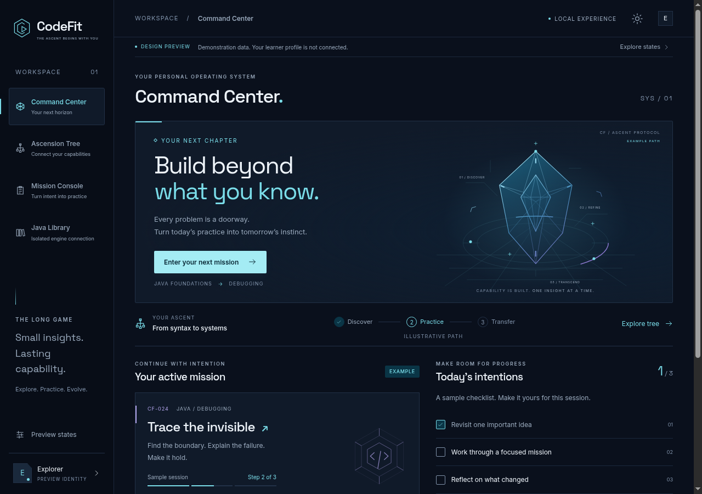 | 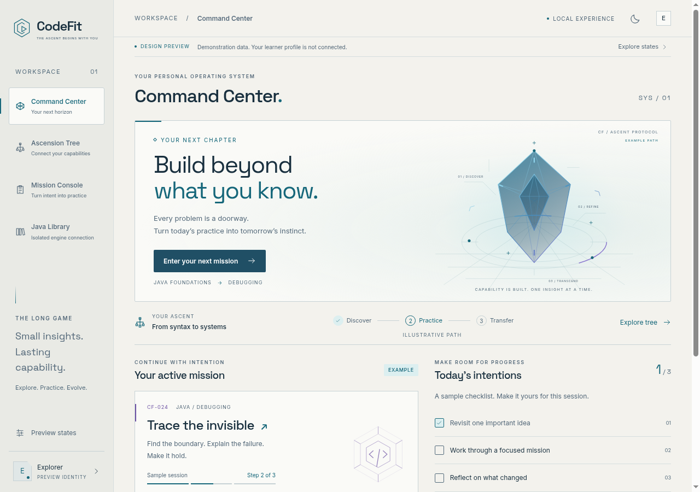 |
| Command Center · 760 | 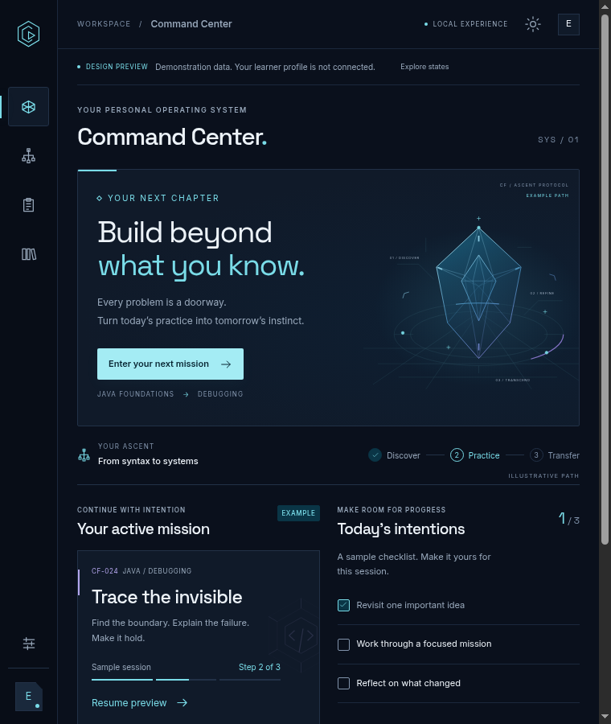 | 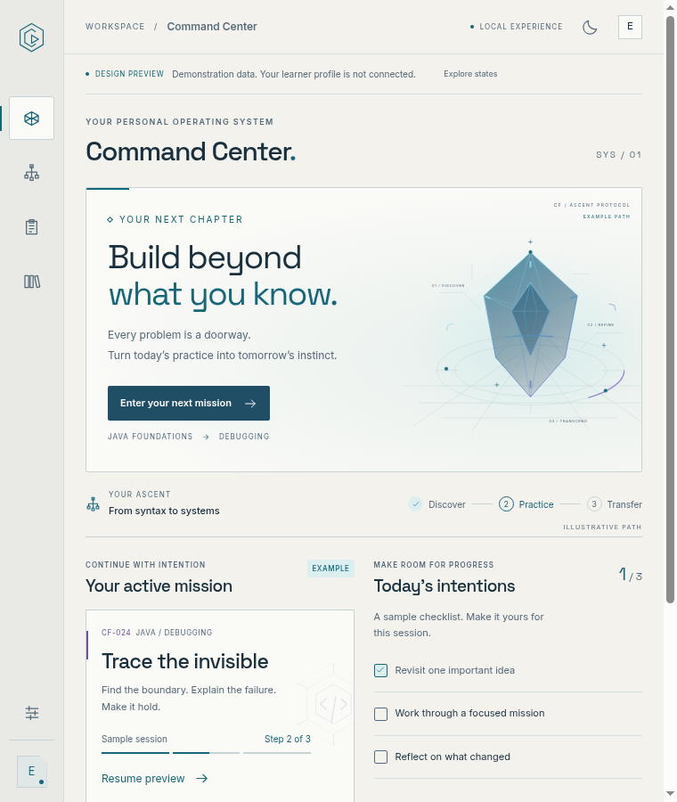 |
| Ascension Tree · 1280 | 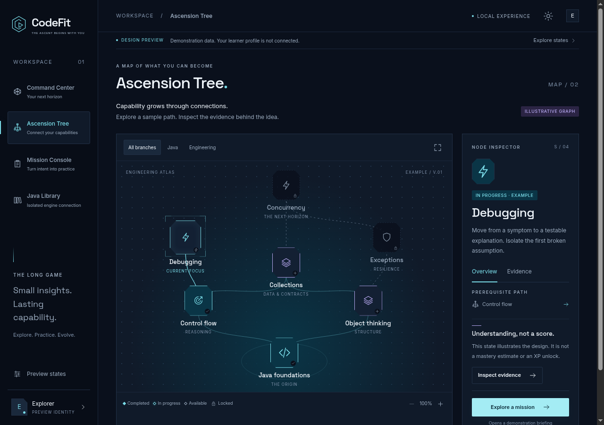 | 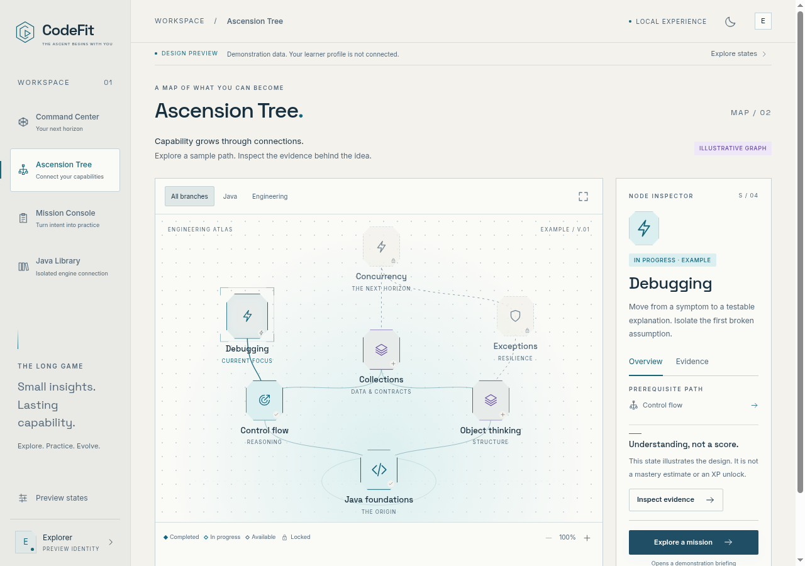 |
| Ascension Tree · 760 | 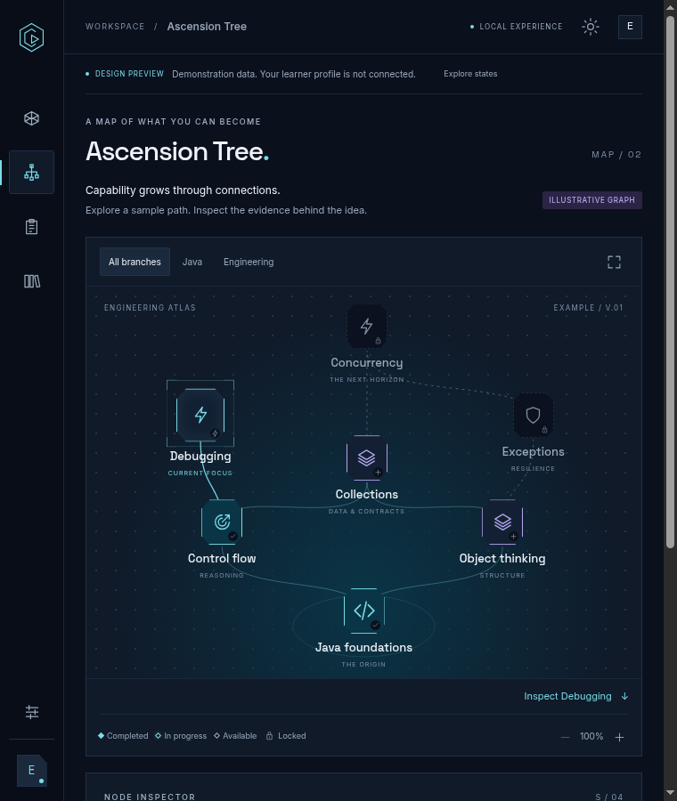 | 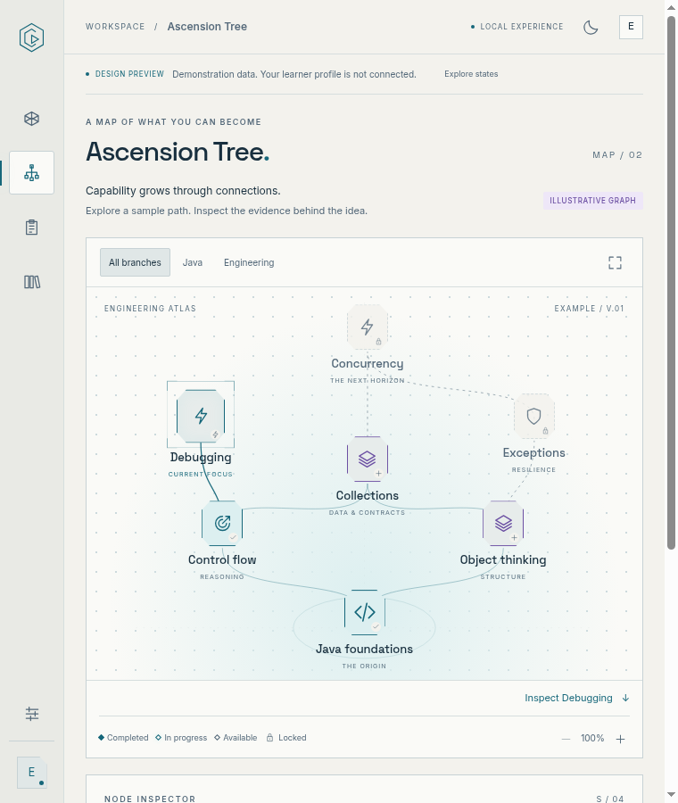 |
| Mission Console · 1280 | 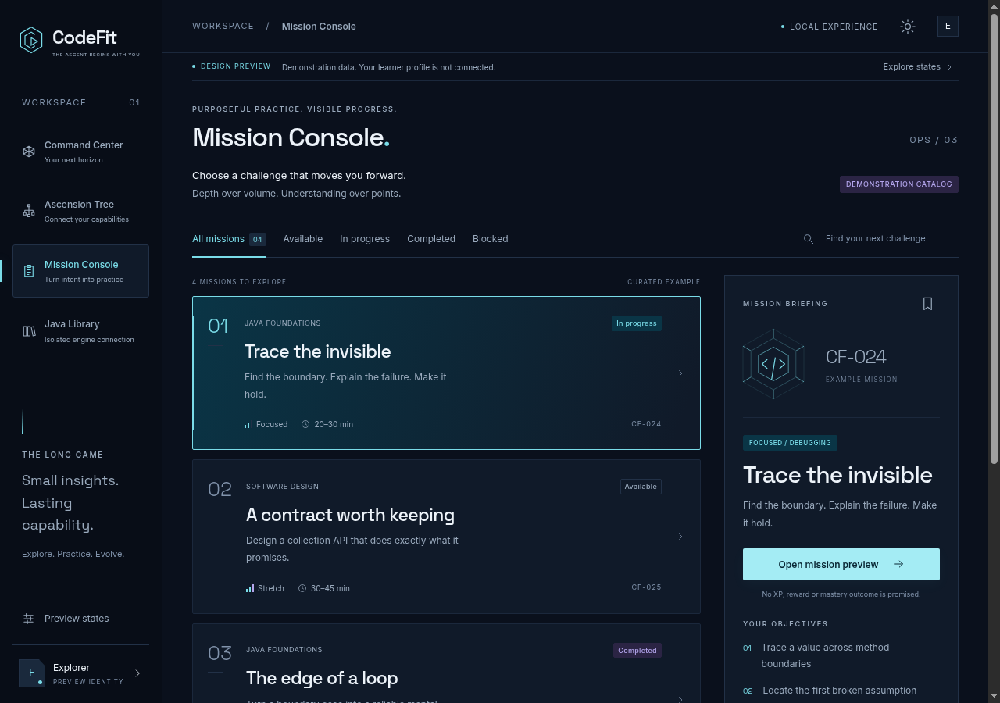 | 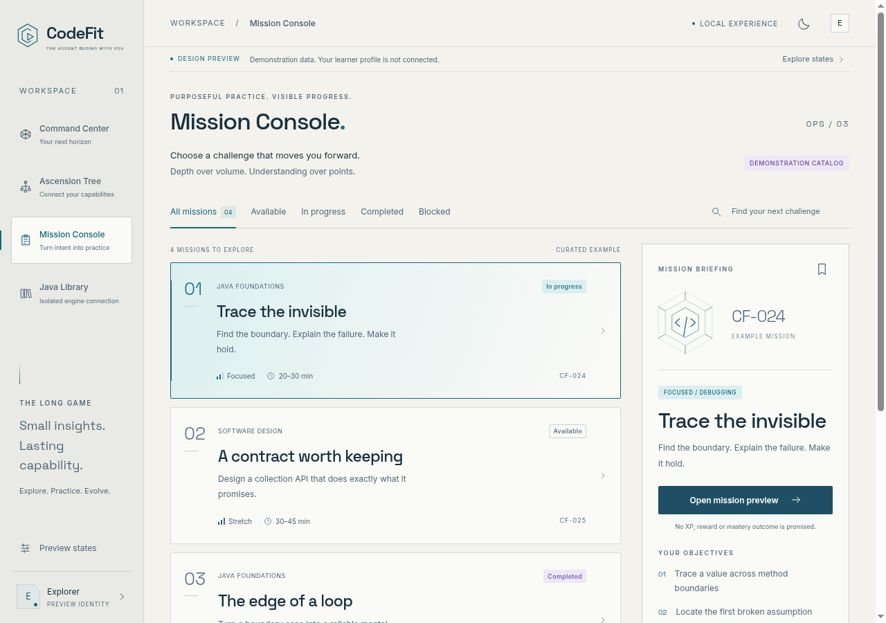 |
| Mission Console · 760 | 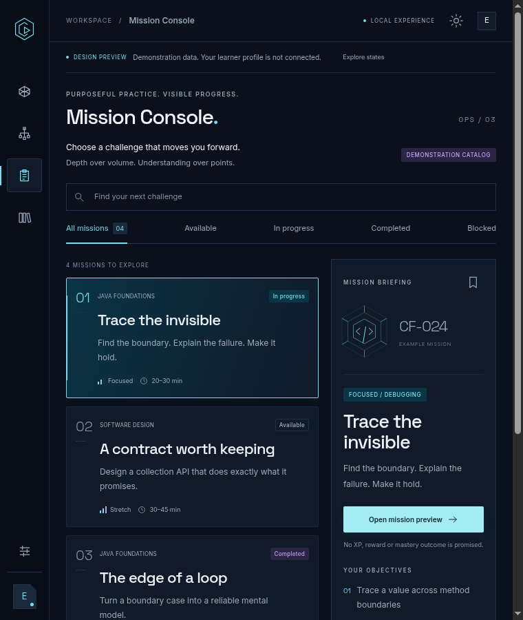 | 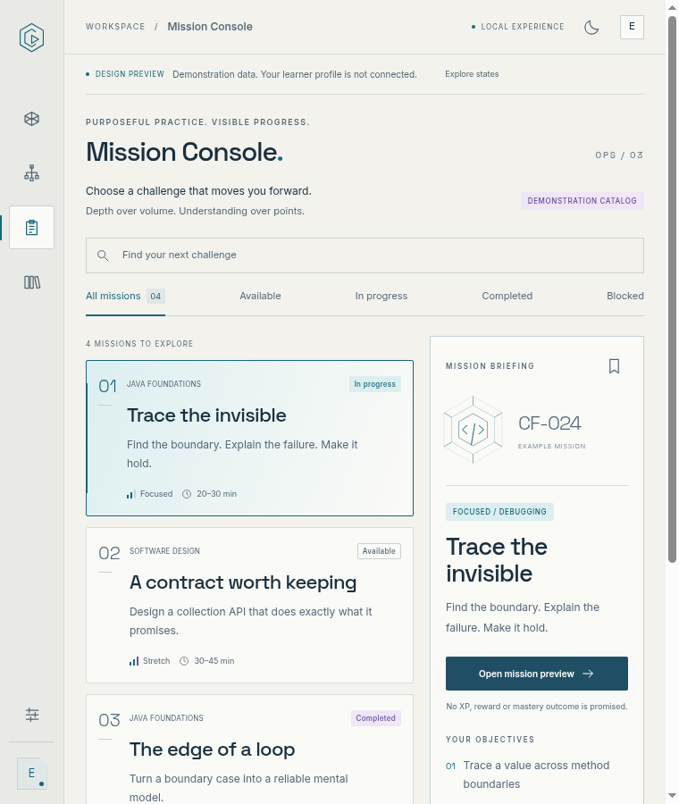 |

## Interaction direction and implementation

There is no previously approved visual baseline: #255 was rejected, and Gate 0 was an architecture preview. The side-by-side comparisons above show this proposal’s actual themes/layouts. The original required interaction direction is compared to its implemented form below; no rejected design is described as approved.

| Required direction | Implemented reviewable experience |
| --- | --- |
| Command Center → recommendation → mission details | Prominent hero action and active sample mission open a native modal briefing |
| Mission → Ascension Tree → skill evidence | View skill path, connected button nodes, prerequisite navigation, evidence scenarios |
| Mission Console → evaluation/recovery inspection | Search/filter/brief, memory-only workspace, simulated interrupted/unavailable evaluation |
| Immersive but practical, not an ordinary admin grid | One faceted centerpiece, linear progression, a connected atlas and typographic mission rows |
| Deliberate light/narrow versions | Mineral light palette, icon rail, readable map with inspector below, retained list/detail context |
| Truthful evidence and progression | Persistent provenance; XP/rank/rewards unconnected; example/unknown/stale/contradictory labels |

Lower Command Center: [dark desktop](screenshots/command-details-dark-1280.png), [light desktop](screenshots/command-details-light-1280.png), [dark narrow](screenshots/command-details-dark-760.png), [light narrow](screenshots/command-details-light-760.png). Narrow tree inspector: [dark](screenshots/tree-inspector-dark-760.png), [light](screenshots/tree-inspector-light-760.png). [2× native rendering](screenshots/command-dark-1280-2x.png).

Additional inspection: [unconnected profile](screenshots/profile-unconnected.png), [achievement design specimen](screenshots/activity-achievement-specimen.png). Light/narrow states: [empty](screenshots/empty-light-760.png), [offline](screenshots/offline-light-760.png), [error](screenshots/error-light-760.png).

State evidence: [unknown](screenshots/state-unknown.png), [empty](screenshots/state-empty.png), [offline](screenshots/state-offline.png), [loading](screenshots/state-loading.png), [error](screenshots/state-error.png), [stale evidence](screenshots/evidence-stale.png), [contradictory evidence](screenshots/evidence-contradictory.png), [unsaved edits](screenshots/workspace-unsaved.png), [interrupted evaluation](screenshots/evaluation-interrupted.png), [unavailable evaluator](screenshots/evaluator-unavailable.png), [light/narrow reduced motion](screenshots/loading-light-760-reduced-motion.png).

## Visual approval checklist

Implementation evidence is provided for review; all approval boxes remain unchecked.

- [ ] Approve the exact implementation commit identified in verification, or request revisions.
- [ ] Approve Command Center hierarchy, centerpiece, sample progression, objectives and journal in both themes/widths.
- [ ] Approve Ascension Tree geometry, state distinction, paths, selection, evidence and narrow exploration.
- [ ] Approve Mission Console selection, filtering, briefing, workspace and simulated evaluation/recovery states.
- [ ] Approve typography, contrast, spacing, iconography, motion and focus behavior after using the prototype.
- [ ] Approve provenance language and unknown/empty/offline/loading/error/stale/contradictory/unsaved/unavailable specimens.
- [ ] Record accepted limitations and required follow-up changes, including native Windows/macOS and screen-reader verification.
- [ ] Product owner comments explicitly on #259 or the draft PR, naming the exact screens/themes/states and commit approved.

Approval comment: **none**. Passing CI, technical review, silence and the merge of Gate 0 do not constitute visual approval. Do not merge this PR or begin large-scale backend integration until the product owner has reviewed the actual experience.
