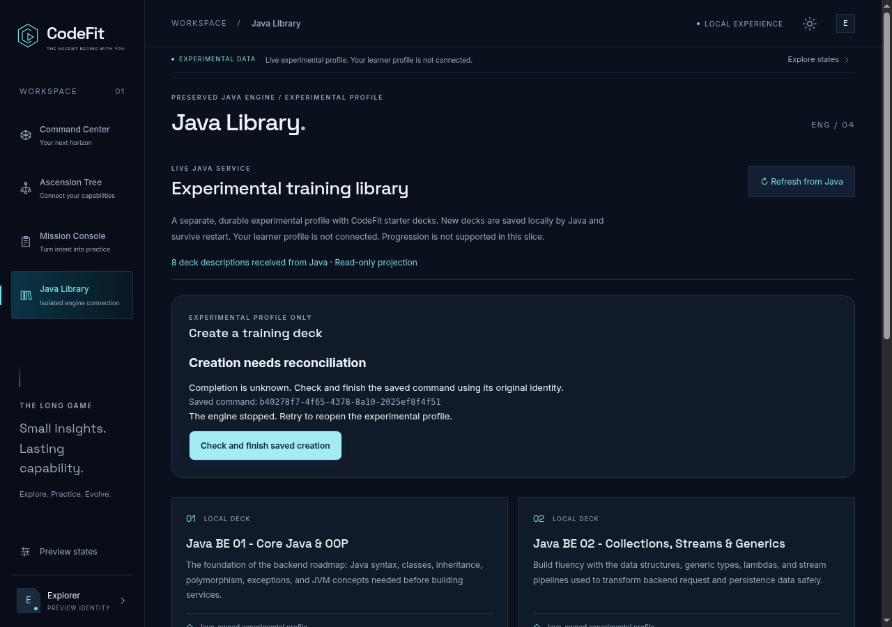
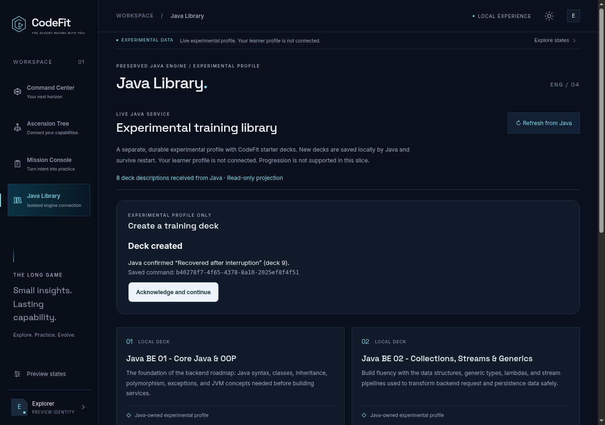

# Gate2 review: authoritative library and recoverable creation

This is the narrow headless Java application slice for [#261](https://github.com/MrH3lmy/CodeFit/issues/261) under [#256](https://github.com/MrH3lmy/CodeFit/issues/256). It starts from approved Gate1 PR #263, keeps the three approved preview screens, and adds one live read/create workflow in **Java Library**. All writes use a separate durable experimental profile. No learner profile is connected or opted in.

- [Decision and audit](../adr-0002-headless-library-boundary.md)
- [Exact API, command matrix and ownership map](api.md)
- [Build/run instructions](../../../desktop/README.md)
- [Verification and limitations](verification.md)
- [Screenshot integrity manifest](evidence.json)

## Review the actual app

Build and launch the packaged app using the desktop README. Open **Java Library**. Initial startup creates the marked experimental profile and its starter decks, then reads the descriptors through a read-only connection. Create a named deck. Java returns the committed deck identity or a durable name-conflict rejection. Close and reopen the app: the saved receipt is reconciled from the same profile. Acknowledge it, then use **Next page of decks** to see the created deck in the authoritative ID-ordered projection.

The profile and command receipt persist; a browser reload does not silently create a new command. Command Center, Ascension Tree and Mission Console retain their demonstration-data provenance. XP, mastery, rewards and mission outcomes are not inferred from deck creation.

## Actual artifact screenshots

These PNGs come from the packaged Electron 44.9 / Java21 application running offline with `chromiumSandbox: true`. Theme transitions are settled before capture. The form and receipts extend only the existing Java Library surface. The [approved Gate1 gallery](../gate1/README.md) remains unchanged; all nine Gate1 interaction/composition/accessibility tests pass.

| State | 1280px | 760px |
|---|---|---|
| Live library, dark | [View](screenshots/dark-1280.png) | [View](screenshots/dark-760.png) |
| Live library, light | [View](screenshots/light-1280.png) | [View](screenshots/light-760.png) |
| Confirmed creation, dark | [View](screenshots/created-dark-1280.png) | [View](screenshots/created-dark-760.png) |
| Confirmed creation, light | [View](screenshots/created-light-1280.png) | [View](screenshots/created-light-760.png) |

| Unknown after a lost reply | Reconciled from Java |
|---|---|
|  |  |

Additional evidence: [pending response](screenshots/pending-dark-1280.png), [durable name rejection](screenshots/name-rejected-dark-1280.png). The unknown/pending captures use test-only transport faults after a real Java transaction. Production has no fault-injection switch or testing IPC endpoint.

## Failure-state walkthrough

| Trigger | Visible/observable result | Recovery and invariant |
|---|---|---|
| Normal create | **Deck created**, authoritative deck ID and saved command ID | Acknowledge to begin another deliberate command |
| Same name under a new command | **Name already exists** | Rejected receipt persists; no additional deck |
| Reply lost after commit | **Creation needs reconciliation**, never assumed success | Check the saved command; Java returns its original receipt |
| App/renderer dies before acknowledgement | Saved intent remains in main's journal | Reopen Java Library; status-only lookup recovers the committed outcome |
| No receipt found after an interruption | Completion stays unknown | Explicit recovery replays the original ID/payload; it never creates a replacement ID |
| Cancel or timeout | Connection stops; message explains that a write may have committed | Status lookup distinguishes a receipt from unknown completion; late UI responses are suppressed |
| Java sidecar crashes | Connection needs attention | Refresh reopens the same owned profile; SQLite recovers unfinished transactions |
| A transaction dies before commit | No committed deck or receipt | SQLite hot-journal rollback during owned startup; same command may safely retry |
| Second app/process tries the same profile | Electron focuses the existing instance or Java returns `PROFILE_BUSY` | No second writer; retry after the actual owner exits |
| Saved operation belongs to a replaced profile | `PROFILE_MISMATCH` | No replay or acknowledgement against the wrong profile; retain files for review |
| Bad/oversized protocol, invalid version or private field | Transport fails closed | No generic RPC, SQL, path or content request is executed |
| Corrupt journal or unsupported profile/schema | Explicit blocked state | Keep files for review; no automatic replacement, migration or valuable-data deletion |

The deterministic demonstrations are in [Electron E2E tests](../../../desktop/tests/e2e/desktop.spec.ts), [main/session tests](../../../desktop/tests/desktop-application.test.ts), and [Java integration tests](../../../src/test/java/com/codefit/desktop/DesktopApplicationIntegrationTest.java). They use only isolated profiles and learner sentinel files.

## Deliberately unsupported

Real learner-profile selection/import/opt-in, schema migration of existing experimental data, evidence/mastery/reward/adaptive endpoints, challenge/problem content, assessment exposure, drafts/submissions, grading, compile-run/cancellation, P2P, native installers and cutover are outside this slice. There is no general filesystem or SQLite bridge. The bundled reduced Java runtime is not a replacement for the existing coding runner.

The cooperative lock protects the current JavaFX/headless launchers; older binaries and external database tools do not participate. Native Windows/macOS lock, filesystem durability and packaging behavior remains unverified. Gate1 follow-ups (branch membership metadata, spatial arrow traversal, reduced-motion scroll behavior) remain nonblocking and unchanged.

The PR remains draft for independent review and product-owner approval; no automatic merge or visual approval is inferred from tests.
