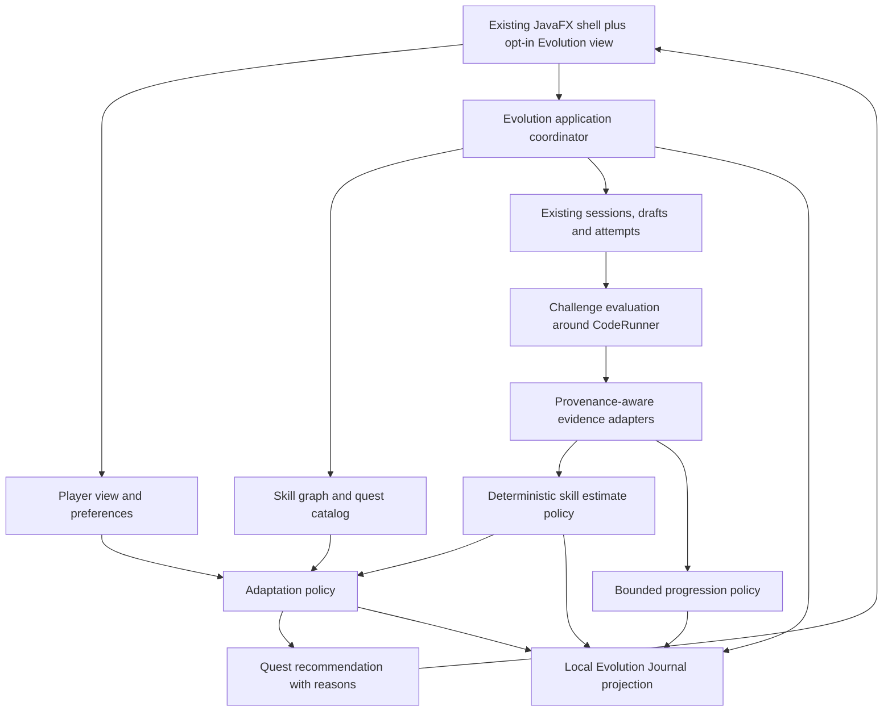

# ADR-EV-0001: A bounded, local Evolution layer

- Status: proposed for #209 review; implementation begins only in follow-up tickets.
- Date: 2026-10-15.
- Context: [audit](existing-system-audit.md), [#208](https://github.com/MrH3lmy/CodeFit/issues/208), completed #164/#104, ongoing #179.

## Decision

Keep one Java 21/JavaFX desktop application and its local SQLite database. Add a small Evolution
application layer composing existing services through explicit adapters. The eight conceptual
responsibilities below are logical boundaries, not deployments, message brokers or mandatory classes.
Use pure policies over immutable inputs with injected `Clock`, stable sort order and explicit versions.
Persist observations and decisions locally. No central server, account, telemetry, ML or required AI.
AI may offer explicitly requested explanations; it cannot authoritatively grade, mint evidence or
silently receive private material. The entire V1 loop works offline with bundled original content.

All persisted nodes use the same SQLite database. There is deliberately no arrow to peer networking.
Existing review/curriculum flows can continue without entering Evolution.

## Responsibilities and ownership

| Responsibility | Owns | Reuses / boundary |
| --- | --- | --- |
| Player Model | Goals, chosen domain/track, budget, pause/defer preferences; composed view of estimates, history and engagement | Read `UserProgress` and existing focus preferences; not a second identity, XP balance or social profile. One local learner in V1, no UUID/account framework needed. |
| Skill Graph | Stable skill definitions, observable behaviors, prerequisite edges, immutable definition versions, retired IDs | Existing string categories are mapped explicitly, not replaced. Prerequisite DAG is independent of imported roadmap order. |
| Evidence Engine | Versioned source-to-skill mappings, event identity, provenance/assistance/exposure snapshot, correction/retraction lifecycle | References existing attempts/reviews/assessments and new evaluations; never copies their answer/code/timing histories into a second attempt log. |
| Quest Engine | Curated offline definitions and available challenge choices; eligible candidate resolution | Calls existing curriculum frontier if track is curriculum; Evolution track is explicitly selected. Does not reorder workbook or implement the card scheduler. |
| Challenge Evaluation | Rubric/check execution for exact submitted artifact, durable run/check outcomes | Wraps `CodeRunner`, validators, `JavaExecutionCoordinator`, existing draft/session persistence. External imported problems keep manual judge recording. |
| Adaptation Engine | Pure deterministic next-action policy and persisted decision reasons/inputs | Uses estimates, negative evidence, exposure, prerequisites and preferences. Does not grade or award XP. Quest engine resolves its chosen action into catalog content. |
| Progression Engine | New idempotent reward ledger, bounded effort/milestone awards and unlock projection in #217 | One combined total via `ProgressService`/`UserProgress`; never writes a mastery estimate. DailyQuest remains an activity feature. |
| Evolution Journal | Local readable timeline joining evidence, evaluations, estimate revisions, decisions and learner choices | Structured references and reason codes; does not duplicate raw observations, notes, rewards or create a generic event-sourced database. |

Proposed package placement: pure values/policies in `com.codefit.evolution`; adapters/coordinator in
`com.codefit.service`; repositories follow existing `com.codefit.repository` conventions. Keep the
first implementation small; a responsibility can be a pure method rather than an interface hierarchy.
No reflection-based plugin discovery, universal agent framework or remote domain execution API.

## Source of truth per datum

| Datum | Authoritative owner | Derived/read model and forbidden write |
| --- | --- | --- |
| Imported problem identity/order | `problems`, `roadmap_entries`, existing importer/ProblemService | Quest selection delegates; skill graph cannot mutate order. |
| Attempt, phase times, draft, local tests, reflections | Existing problem/review/assessment repositories | Evidence stores pointers and classification; never creates a second source attempt or overwrites history. |
| Manual judge verdict | Existing `ProblemAttempt.submissionResult` | Label learner-reported; neither local pass nor AI can silently turn it into authenticated external AC. |
| New submitted artifact/check result | Immutable evaluation record + local artifact reference/hash | Mutable draft is not evidence. Check pass is rubric-local verification only. |
| Per-event provenance, assistance and exposure | Snapshot at source/evaluation commit; legacy unknown preserved | Latest progress/session/card metadata cannot reconstruct missing historical facts. |
| Skill definitions and mappings | Versioned skill repository and mapping definitions | No skill membership → mastery inference. |
| MasteryEstimate | Rebuildable estimate revision from identified evidence set + policy/version + as-of | Not source evidence; never writes Flashcard intervals, XP or interview readiness. |
| Engagement total/streak | Existing `UserProgress`; new reward entries applied atomically once | Legacy opening balance preserved. No separate Evolution balance. |
| Recommendation / learner choice | Decision and choice records, policy inputs/version | Journal projects these; current screen state is not an audit log. |
| Peer identity/consent/signed summary | Existing peer services and protocol | Local Player/evidence never serialized by default; no received peer result enters personal estimates. |

## Minimal additive persistence plan

These are logical storage contracts for follow-ups, not DDL or reserved migrations in this PR.

| New storage / owner | Minimum keys and purpose | Existing data reused |
| --- | --- | --- |
| Skill definitions + prerequisite edges (#210) | `(skill_id, definition_version)`, domain, behaviors, lifecycle; graph-version pinned edges with exact endpoints | String category mapping is separate from definitions. |
| Skill evidence + target mappings (#211) | Unique source event/revision + mapping version; source reference, classification snapshot, correction link; target skill/version/check links | Existing review, assessment, problem attempt, later evaluation IDs. Answers/notes not duplicated. |
| Evolution quest/challenge binding and exposure (#213) | Immutable manifest ID/version/hash; variant/family/cohort and backing problem ID; first presentation/exposure records | Bundled assets authoritative; no duplicate problem statement bank in SQLite. |
| Submission context / evaluations (#214) | Command key, backing problem, linked existing attempt ID, exact content versions, artifact digest/ref, assistance/exposure snapshot, run/check outcomes | Existing Problems, attempts, drafts, phases; no `quest_attempts` copy of attempt rows. |
| Estimate revisions (#212) | Skill ref, policy version, input evidence IDs/digest, as-of, band/confidence/reasons, estimate epoch | Rebuildable projection, not a second performance-event log. |
| Decisions / choices (#215/#216) | Decision key, candidate IDs and exclusions, evidence/estimate refs, policy/config version, chosen action/reason, learner response | Journal is a query over these and the preceding records. |
| Reward ledger (#217) | Unique entitlement key, policy version, delta, source link, applied status within transaction | Existing `user_progress` balance/level. No XP backfill from evidence import. |

Player goal/track/budget/pause settings can be additive `user_progress` fields in #212/#216, following
existing settings. Do not duplicate existing budget fields. Tables should be introduced only by their
owner ticket. Archive immutable manifests needed to interpret old evidence; active version pointers
can change, but pinned historical versions cannot.

### Backing executable content without duplicating attempts

For original Java challenges, #213 binds each immutable variant/version to a `Problem` using reserved
platform `CODEFIT_EVOLUTION` and external code containing challenge ID/version/variant. A changed
rubric may reuse a problem only if content/exposure identity is unchanged; changed content gets a new
binding. URL may be null (supported by `ProblemService`). Never add these to `roadmap_entries`.
Use the existing sessions, drafts and attempts for that problem. A submission context contains only
new metadata; each finalized submission links exactly one existing `ProblemAttempt`.

Ordinary `ProblemLibraryService.getTopicBasedEntries()` currently loads all problems, so **a reserved
platform alone is insufficient**. #213 must supply catalog-aware exclusion of Evolution content from
ordinary browsing, topic suggestions, new curriculum selection and weekly assessment selection.
#216 enforces the same boundary in navigation. Presented tasks are marked exposed before rendering;
opening via an alternate entry point also counts. Held-out roles are BASELINE, PRACTICE, RETENTION,
TRANSFER, PILOT_POST; they are mutually exclusive pools, and a family cannot serve as both baseline
and claimed transfer for the same capability check. Baseline/transfer assets are local and inspectable,
not secure exam secrets. Learners can disclose prior familiarity; that invalidates an unseen claim.

Reuse #104's separate assessment bank for compatible non-executable assessment prompts; don't
mirror its items as Problems or create another quiz bank. Its rotation is insufficient for V1's held-out
claims: reserve the new Evolution cohorts from the ordinary weekly selector. Executable baseline and
transfer checks use the challenge catalog/evaluator, not subjective `JAVA_CODE` assessment grading.

### Privacy consequence of reusing attempts

Current `ProgressSnapshotService` reads problem attempts globally, so new `CODEFIT_EVOLUTION`
attempts could otherwise enter existing consented problem aggregates. Before #214 persists them,
add a narrowly scoped exclusion by backing platform in snapshot queries (including ambiguous-origin
checks and fresh-first-completion totals), while preserving all existing imported-problem semantics.
Test that opted-in legacy scopes see identical aggregates with/without Evolution rows. This is a local
source-selection guard, **no change to wire formats, metric definitions, grants, sync or networking**.
Evolution sharing requires a separate reviewed versioned aggregate contract and fresh explicit consent
in a future ticket. Neither this PR nor #210 expands existing sharing. Raw code, notes, statements,
answers and journals never go to peers; see [source attribution](../problem-solving-source-attribution.md).

## Commit, replay and migration boundaries

- Reuse `DatabaseConfig`, `SchemaMigrator` and `Transactions`; add shared-Connection overloads
  only to repositories that participate. Enable/check foreign keys for the new transaction connections;
  do not assume the initializer's PRAGMA applies globally. Validate referenced IDs even with FKs.
- #214 snapshots a submit command and exact source before executing, runs outside any DB
  transaction, then commits attempt + evaluation + context + evidence together. Capture assistance
  before session reset. Never call today's multi-write `finish()` as if it were atomic or replay-safe.
  Legacy callers remain unchanged; the coordinator may share extracted pure mapping helpers.
- A stable persisted submission key, not count+1 or a source hash, deduplicates completion. A new
  deliberate reattempt has a new key but the same exposure/family, so cannot add independent proof.
  Finalization is serialized for one learner/problem and protected by unique constraints. On busy/error
  roll back; retry the same command, not a freshly numbered attempt.
- Source adapters for older flows run after source commit in bounded batches with a transactional
  cursor and unique event keys; restart rereads are harmless. A mapping-version change supersedes
  prior interpretations, not extra independent observations. #211 must scan beyond display limits.
- Schema migration numbers are allocated after rebasing on current main, not reserved here. Peer
  work shares `schema_migrations`; conflicting numbers/order must be resolved before merging.
  Migrations are additive and rollback on failure. Backfill is resumable application work, not a huge
  startup migration. Older records keep timestamps, unknowns and original outcomes.
- New schema tests upgrade a populated pre-Evolution DB, rerun initialization/backfill, assert original
  rows/totals/order unchanged, inject failure and reopen. Use `IsolatedDatabaseExtension` plus its
  resource lock; no learner database or real identity keys in fixtures.

## Versions, correction, deletion and explainability

Version independently: contract format, skill/graph definition, source mapping, challenge/variant,
rubric/check manifest, estimate policy, adaptation config and XP policy. Record all relevant versions
at commit; unsupported versions yield unavailable/unsupported, never a guessed conversion. Sort by
persisted event time then stable ID, with explicit time basis and as-of; policies receive no hidden clock.

Evidence is append-oriented, with explicit supersedes/retracts links. One current interpretation per
source observation/target under the chosen mapping; changing the mapping never multiplies sample
count. Regrade creates a new evaluation revision with reason and retained prior record. Broken checks
retract their skill contribution. Estimates/decisions reference the effective evidence set and remain
historically readable after policy upgrades. New policy recomputation creates a new projection version.

Deleted/unavailable sources are marked unavailable and excluded from positive proof on rebuild;
absence must never recreate evidence. Journal retains bounded structural references and an unavailable
label, not copied private content. A user-requested experimental estimate reset starts a new epoch,
leaves source history intact and documents which earlier evidence is excluded from active estimation.
Old decisions remain traceable. Explicit deletion/export of private evidence needs its own UI policy;
append-oriented does not mean refusing a learner's deletion request.

## Trade-offs, risks and deferred decisions

| Choice | Benefit | Cost / limit / follow-up |
| --- | --- | --- |
| Ordinal deterministic skill bands | Testable, explainable, no fake probabilities | Thresholds uncalibrated; #218 must evaluate usefulness before expansion. |
| Existing attempt/workspace reuse | One source history and editor/runner | Requires context snapshots, atomic path, discovery and privacy exclusions; include tests in #213/#214. |
| Local curated executable checks | Offline reproducibility and bounded scope | Cannot prove all thread schedules, authorship or prevent local tampering. Hidden means withheld by UI only. |
| Derived journal and estimates | No duplicate event store or counters | Retain input references/versions; source deletion reduces replayability and must be visible. |
| Separate Evolution and workbook paths | Preserves authoritative order and agency | UI must show which path a recommendation belongs to. |
| No peer integration | Protects ongoing #179 contracts | Future sharing needs separate consent, aggregate design and compatibility review. |

Unresolved implementation details within these boundaries: exact Java harness packaging (#213/#214;
prefer one public `Main` wrapper matching current runner), final migration allocation after rebase, and
retention/cleanup bounds for local diagnostic artifacts (#214). These must be resolved in those PRs;
none authorizes replacing the stack or silently weakening grading. Initial bands/cadence are specified
in the lifecycle, but efficacy and timing fairness remain research questions for #218.

Rejected: microservices/event bus; a second problem/review/XP database; universal numeric "power";
XP-driven mastery; automatic AI graders; importing peer performance into personal proficiency; a
remote-code marketplace; universal sandbox claims; automatic cross-domain cognitive inference.
