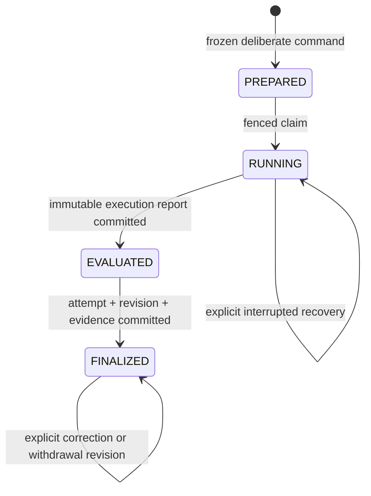

# Durable local challenge evaluation (EV-06)

Implementation of [#214](https://github.com/MrH3lmy/CodeFit/issues/214), under
[epic #208](https://github.com/MrH3lmy/CodeFit/issues/208), based on main
`2d60c9bf5e63b2b9f89f8304f20ab45be1673c8c` (merged #226, migration 15).

A local result describes the submitted artifact under a pinned, bounded rubric. It does not establish
mastery, independence from outside help, universal thread safety, or improvement on unfamiliar work.
This release supports the installed Java pack and keyed diagnostics. Unrecognized source mechanisms
and future rubrics fail closed. It is not a general Java verifier or a security sandbox.

## Authoritative owners

| Data | Owner and implementation |
| --- | --- |
| Skill/graph definitions | Existing `SkillCatalogRepository`; exact versions in the published challenge |
| Quest, challenge, family, variant, cohort, rubric, asset digests | Existing `QuestCatalogRepository`, immutable migration-15 manifests; no v1 content changed |
| Presentation authorization, prior exposure, hints/solution reveals | Existing `ChallengePresentationService.contextForSubmission(Connection, id)` and `ChallengeExposureRepository` |
| Mutable editor and timer | Existing `JavaSolutionDraftRepository` and `ProblemSolvingSessionRepository`; finalization does not overwrite either |
| Deliberate command and frozen artifact/context | [SubmissionSnapshot](../../src/main/java/com/codefit/evolution/evaluation/SubmissionSnapshot.java), [DurableEvaluationRepository](../../src/main/java/com/codefit/evolution/evaluation/DurableEvaluationRepository.java) |
| Execution and per-check outcomes | [JavaChallengeEvaluator](../../src/main/java/com/codefit/evolution/evaluation/JavaChallengeEvaluator.java), existing `CodeRunner` / `JavaCodeRunner` and global `JavaExecutionCoordinator` |
| Controlled mechanism admission | [JavaMechanismVerifier](../../src/main/java/com/codefit/evolution/evaluation/JavaMechanismVerifier.java); versioned conservative JDK AST checks, no generated bytecode or second runner |
| Staging, recovery, cancellation, atomic completion | [ChallengeEvaluationCoordinator](../../src/main/java/com/codefit/evolution/evaluation/ChallengeEvaluationCoordinator.java) |
| Problem attempts | Existing `problem_attempts`, with `SubmissionResult.LOCAL_EVALUATION`, explicit frozen UTC submission time and `FRESH_ATTEMPT` origin; never AC/ACX |
| Diagnostic source attempts | Existing reserved `assessment_attempts`, only when there is an objective boolean outcome; no Java attempt for keyed tasks |
| Canonical observation, interpretations and corrections | Existing `EvidenceRepository`, now validating the exact durable evaluation on the caller's connection; one observation root per deliberate submission |

No new curriculum rows, generic attempt store, XP writes, mastery estimates, recommendation policy,
P2P fields, network messages, or UI routes are introduced.

## Submission API and immutable context

The future #216 UI must first obtain a persisted presentation from the existing presentation service.
It then calls `submit(new SubmissionRequest(commandId, presentationId, artifact, outsideAssistance,
reflection))` off the JavaFX thread. It may use `prepare`, `resume`, `status` and `cancel` separately.
A command ID is a deliberate submission identity, not an artifact hash. Retrying an uncertain response
must reuse that ID; using a new ID intentionally creates a separate, correlated attempt.

The artifact is the learner's local source fragment containing `Exercise`, or a full saved draft
ending in the exact installed trusted harness. The assembled program always appends the pinned harness;
additional/replaced `Main` classes cannot execute. Keyed tasks accept response text instead of Java.
Raw artifact and assembled-source SHA-256 are separate. No source is read from a mutable draft during
execution. The caller supplies explicit artifact bytes as valid UTF-8 text (200 KB maximum).

`prepare` holds one short writer transaction. On that same connection it obtains the presentation
context, validates the exact quest/challenge/backing, checks installed asset digests, freezes canonical
quest/challenge manifests (including GraphRef, SkillRefs, rubric/checks/assets), timestamps, profile,
reflection, current aid history, original presentation history, prior family/variant submission counts,
persisted phase timers and the recorded legacy session hint level. It publishes an immutable exact evidence mapping and inserts PREPARED.
No attempt or observation exists yet. A replay compares the complete original request, including aid
and reflection declarations. Different content under the same command ID rejects without side effects.

Prior submission counts also include abandoned/prepared commands: they conservatively prevent an
interruption from restoring an "unseen" classification. Repeating the same presentation is REPEAT;
a different variant of the same family is RELATED_VARIANT. FIRST_PRESENTATION means first recorded
on this database. Cohort labels never automatically imply verified transfer or delayed retention.
Known familiarity and solution reveal remain frozen even when the source bytes are later changed.
Unknown outside assistance stays UNKNOWN; an explicit absence declaration is still a learner statement.

## Transactions and recovery

Compilation, source inspection, process waits and checks occur outside database transactions. Short
process-start checkpoints persist the current child PID/start identity; no database lock spans a
compile/run wait. Process registration counts toward the same monotonic execution deadline, so
checkpoint delays cannot extend a check's time allowance. Existing global Java coordination prevents overlap with ordinary workspace runs.
A busy operation returns its durable PREPARED/RUNNING state, without polling or inventing a failure.

Each claim has a random fencing token, owner PID/start identity and bounded execution number. A live
other process is never displaced. A dead owner or an abandoned operation in the current process can
be reclaimed only after acquiring the global operation. Registered orphans are terminated outside SQL
transactions before retry; PID/start comparisons protect unrelated processes after PID reuse. Unknown
or unverifiable live orphan identity blocks automatic recovery. Three interrupted executions exhaust
the retry budget; the next resume finalizes INCONCLUSIVE without executing again.

The immutable run report and EVALUATED transition commit together. A restart from EVALUATED finalizes
that report without executing again. The final writer transaction creates the existing source attempt
when applicable, immutable evaluation revision, final source links, canonical evidence observation and
aliases. Any failure rolls all these effects back to EVALUATED. A commit followed by a lost response
returns the same saved result on replay. A stale fencing token cannot stage or finalize another run.
SQLite availability failures leave a recoverable stage, never fabricated success.

Cancellation before staging is persisted and overrides the execution result with CANCELLED. Same-process
cancellation also kills the attached compiler/program. A cross-process request is observed at process
registration or staging; otherwise the active process remains subject to its normal bound. Once
EVALUATED, cancellation returns the existing authoritative report rather than rewriting it.

`unfinished(afterId, limit)` is an indexed, bounded keyset page (1–64 commands). The caller can obtain
the numeric cursor from `find(commandId)`. There is no new startup scan, unbounded polling or background
submission worker. #216 must expose pending/recoverable states and deliberate resume controls.

## Checks and guarantees

Only exact installed version-1 challenge/rubric definitions have this evaluator adapter. New content
versions require an explicit adapter review; their presence in the catalog alone does not authorize
an old evaluator to grade them. Every report contains every declared check ID. An unavailable required
check is never skipped, made optional or counted as passed.

| Kind | Implemented guarantee | Limitation |
| --- | --- | --- |
| DETERMINISTIC_IO | Exact declared stdin, exit and stdout through the frozen trusted Main | Finite functional cases; no universal correctness or atomicity inference |
| KEYED_DIAGNOSTIC | Existing #104 `AnswerValidator`, exact accepted-key matching after surrounding whitespace removal | Keyed diagnosis only; free-form explanation remains ungraded |
| CONTROLLED_TRACE | Validated structural mechanism described below | No claim that stress enumerated schedules; unknown mechanisms UNSUPPORTED |
| OBSERVED_CONCURRENCY | Three bounded repetitions of each published coordinated workload, recording case/repetition, captured-stream hashes, exit and elapsed time | Reports actual finite workloads/repetitions, not reproducible OS schedules or all interleavings |
| TERMINATION | Published bounded join/workload and safety assertions | Timeout/nontermination is INCONCLUSIVE/TIMED_OUT, never automatic proof of deadlock |
| REFLECTION | Immutable submitted reflection retained for future review | UNGRADED; no objective evidence of reasoning quality |

The structural verifier resolves JDK symbols on the learner-only source with annotation processing
disabled and an empty application classpath. It restricts classes, types, constructors and calls;
rejects extra classes, inheritance, escaping object/array APIs, callbacks, reflection, IO, process/thread
creation and unknown operations before executing learner code. This protects check integrity; it is
not host containment. It supports private state with scalar instance API operations wholly synchronized
on the same intrinsic monitor, or one private final AtomicLong/AtomicInteger with exactly one supported
primitive atomic operation per API call on that exact owned scalar receiver, without nested locking
or loops. Arrays/replaceable atomic receivers are not scalar atomic fields. Split get/set protocols do not qualify. Unguarded compound
field updates, including volatile read-modify-write, fail the relevant boundary check structurally.

Five additional reviewed AST fingerprints support the exact authored route-counter callbacks,
private immutable ledger Entry, expiry predicate, stateless pagination filter, and fixed min/max
account-lock ordering. Formatting/comments may differ; semantic changes to these special templates
require another supported mechanism or return UNSUPPORTED. The ordered-lock template has two fixed,
private, distinct locks, no replacement/escape, and min-then-max acquisition; its bounded checks also
verify conservation. The generic single-monitor alternative supports other lock-based repairs.
These fingerprints establish a narrowly reviewed mechanism, not an automatic pass: compilation,
functional and observed checks still execute. They do not classify an unfamiliar implementation as
incorrect merely because it uses another valid technique. Broad callback, CAS-loop, ReentrantLock and
multi-monitor inference is deliberately unsupported in this evaluator version.

No barriers are inserted inside learner critical sections. The packaged harness starts workers before
they enter operations; valid serialized solutions cannot be falsely deadlocked by instrumentation that
requires another thread to enter the same held monitor. The matrix in
[verification](challenge-evaluation-verification.md) checks actual packaged references and mutants.
Version-1 definitions/assets have not been rewritten to accommodate the evaluator.

## Outcomes and evidence

Reports are immutable version-1 binary contracts with bounded UTF-8 fields and collection lengths,
canonical re-encoding, payload SHA-256, all check IDs, per-run diagnostics, evaluator/runtime versions
and timestamps. Java serialization is not used. Stored stream hashes cover captured bounded bytes;
truncated output makes execution INCONCLUSIVE. Private diagnostics can include hidden harness output.
Only the coordinator's redacted `View` is safe to render: no hidden inputs, expected values, answer
keys, reference solutions, raw compiler output or source are exposed by that view.

Overall PASSED requires every required check to pass and no observed counterexample/environment failure.
An empty keyed response is INCONCLUSIVE rather than a capability failure. A real failure with other required successes can be PARTIAL; it is not complete mastery. COMPILE_ERROR,
RUNTIME_ERROR, RESOURCE_EXHAUSTED, TIMED_OUT, CANCELLED, INCONCLUSIVE, UNSUPPORTED, TOOL_UNAVAILABLE and
EVALUATOR_ERROR remain distinct from FAILED. Unavailable execution does not become a capability failure.

One deliberate command produces one CHALLENGE_EVALUATION source root, never one success per check.
Evidence PASS/FAIL/PARTIAL summarizes the actual grade; other outcomes project to UNAVAILABLE.
LOCAL_CHECK means this machine observed the bounded result (including inability to evaluate), not
external authentication. Exact artifact, command, family, rubric/evaluator, checks and source attempt
references must agree with the same-connection durable source projection before append/retrieval.
An immutable mapping `challenge-<manifest-sha-prefix>@1` pins the exact graph and target SkillRefs.

Java aliases use the existing evidence link table. Diagnostic aliases use the new assessment alias
registry; both exclude legacy source interpretations with EVALUATION_AUTHORITATIVE, even after a grade
is corrected or withdrawn. Historical assessment booleans remain LEGACY_UNSPECIFIED. No evidence is
created by viewing, starting, saving a draft, manually marking completion or revealing a solution.

`invalidate(command, correctionId, false)` appends a BROKEN_CHECK / INCONCLUSIVE supersession;
`invalidate(..., true)` appends a learner retraction preserving original facts. Both extend the
existing evidence revision chain, preserve artifact/family/attempt identity and create no new attempt.
Correction IDs are idempotent and payload conflicts reject. Withdrawal is terminal and replays cannot
resurrect it. A changed rubric never silently regrades historical source bytes.

## Persistence, privacy and migration

Additive [migration 16](../../src/main/java/com/codefit/config/ChallengeEvaluationSchema.java) creates:

- `evolution_submissions`: immutable context/artifact snapshot plus mutable staged execution control.
- `evolution_evaluation_runs`: immutable fenced staging reports.
- `evolution_evaluation_revisions`: immutable original/corrected/withdrawn reports and lineage.
- `evolution_evaluation_assessment_aliases`: one reserved diagnostic source alias per submission.

Foreign keys, unique source links, immutable snapshot/report triggers and the deferred final-revision
reference protect transaction integrity. Existing schemas, learner history, curriculum ordering and
published version-1 content are preserved. There is no startup backfill of local evaluations. Back up
the local database before upgrades; downgrading to binaries unable to parse LOCAL_EVALUATION is not
supported after these attempts have been written.

Peer-visible problem metrics use three repository query paths: submitted windows, UNKNOWN-origin
availability, and fresh first completions. All exclude CODEFIT_EVOLUTION independently of verdict or
origin; local markers are also excluded from ordinary activity queries. This covers daily/weekly
attempt, accepted, solving-time and unique-completion values before signing. Readiness uses ordinary
attempt queries and unchanged roadmap scope. Weekly assessment reports exclude reserved diagnostic
attempts. Raw local source history remains available to its owner. No P2P payload, consent or network
contract changes. Corrections/replays add no peer-visible events.

## Handoff and remaining boundaries

Implement **#212 next**: proficiency/baseline policy can consume the existing `EvidenceRepository`
views and `DurableEvaluationRepository.evaluationInput(Connection, commandId)`. This metadata-only
input supplies the canonical observation, exact mapping/graph, quest/challenge/cohort, check kinds,
required flags, behavior targets, statuses, run counts and limitations without source or hidden I/O.
Discover mapping references with `mapping(ChallengeSpec)` from exact catalog versions, skipping
unpublished mappings with no observations. Use the same read snapshot as `forSkill` and compare exact
evidence revisions. Group by submission/family,
reading assistance, exposure, outcomes, limitations and exclusion/revision state. Treat unavailable
results as missing information; distinguish bounded check success from proficiency. Never derive
independent solves from check count, a new variant ID, mapping revisions or XP. #212 must not create
another grader or execution store. #215 owns adaptation and #216 owns rendering/recovery controls.

The installed assets are locally inspectable; UI concealment is not anti-cheat protection. No downloaded
or peer-supplied executable content is accepted by this coordinator. Only the learner's own local work
against installed reviewed assets is supported. Memory limits constrain JVM heap, not total OS resource
use. JDK AST inspection has bounded source size/nesting/type complexity, not an OS sandbox or a hard
in-process CPU guarantee. Normal completion/cancellation closes temporary compiler directories. A hard
process/OS crash can leave local temporary files; process registration has an unavoidable OS-start /
durable-checkpoint gap, so unregistered orphan cleanup cannot be guaranteed. This does not allow an
unfinished/stale execution to commit evidence. No physical power-loss or hostile host containment claim
is made. Linux Java 21 is verified; other platforms need their own runtime validation.
