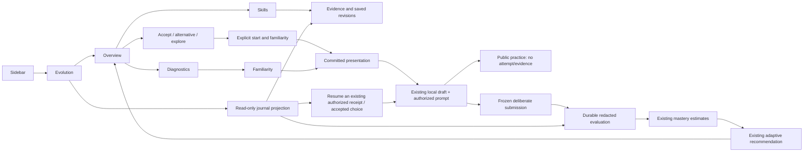

# EV-08: the offline Player System

Implements [#216](https://github.com/MrH3lmy/CodeFit/issues/216) under
[#208](https://github.com/MrH3lmy/CodeFit/issues/208), from merged #234 at
`21198a7e7c1043132d424c0b25dc88914f1b3bd2` (migration 18).

This screen connects existing foundations. It does not grade solutions, estimate skills, select
quests, award XP, or publish peer data independently. A checked pass is never displayed as mastery.

## Screens and navigation

The existing shell and theme remain in use: `Route.EVOLUTION`, `Sidebar`, `NavigationService`,
`AppShellController`, [evolution.fxml](../../src/main/resources/fxml/evolution.fxml) and scoped
[evolution.css](../../src/main/resources/css/evolution.css). All ordinary navigation destinations
remain available. Review/assessment/guided-training distraction-free behavior is unchanged.

Five tabs form one destination rather than disconnected routes:

| Tab | Behavior |
| --- | --- |
| Overview | Purpose/limits, exact track and goal, active-time budget, current recommendation and reasons, safe quest overview, alternatives/exploration, decline/defer/re-enable, pause/resume, skill summaries, latest estimate comparison, latest result and continuation/recovery links. |
| Skills | Exact authored definitions, ordinal band/support/freshness, required/supported/missing behaviors, family count, contradictions, observation time, actual reason codes, contributions/exclusions, provenance/assistance/exposure counts, prerequisites and paged saved revision history. |
| Diagnostics | The three reserved baseline tasks through `BaselineDiagnosticService`; start/skip task/skip all/resume; familiarity declaration and preserved prior submissions. Invariants/liveness are not given fabricated baseline results. |
| Challenge | Authorized prompt, editable local fragment or keyed response, autosave/manual save, ungraded reflection, assistance declaration, hints/solution/familiarity recording, permitted public practice, deliberate evaluation, cancel/recover and safe results. |
| Journal | Chronological metadata projection, bounded pages, stable source references, saved decision/estimate interpretation, source evidence inspection, existing presentation/choice/submission continuation. |

A first-time learner sees UNKNOWN and an actionable baseline recommendation. Expand the direction
controls to select an exact skill goal and a 1–180 minute budget. The default remains **20**; the UI
explains that Java repairs need 30–50 minutes. It never increases the budget silently. Skip/defer/pause
creates no capability failure. The learner can return to ordinary curriculum at any time.

## Ownership and reuse

| Responsibility | Authoritative boundary used |
| --- | --- |
| Exact four skills and prerequisites | `SkillCatalogRepository`, existing published `SkillGraph`; names/descriptions come from the graph. |
| Safe recommendation and quest preview | `AdaptiveQuestService.recommend(clock.instant())`, saved decision candidate metadata and quest title/objective. No prompt/answer/harness asset is read for a preview. |
| All typed learner choices | `AdaptiveQuestService.respond(LearnerCommand)`; acceptance does not present. Explicit start uses `start(choiceId, familiarity)`. |
| Baseline tasks and skips | `BaselineDiagnosticService.status/present/resumePresentation/prepare/skipTask/skipAll/resumeTask/resumeAll`. |
| Prompt, hint, solution, familiarity and exposure | `ChallengePresentationService` only. Content is returned after exposure commits. Existing receipts are resumed with their original declaration; the UI does not reset novelty. |
| Java working source | Existing `JavaSolutionDraftRepository`, original Problem/session binding. `JavaSolutionWorkspaceService` remains ordinary-only; its reserved-content guard is **not** relaxed. The Evolution editor uses the same JavaFX TextArea/workspace styling and original draft owner through its presentation-aware application boundary. |
| Keyed response and working reflection/help declaration | Migration-19 `evolution_working_notes`; no attempt or grading semantics. Java source is not duplicated here. |
| Checks and Java process limits | Existing `JavaChallengeEvaluator`, `CodeRunner`/`JavaCodeRunner`, global `JavaExecutionCoordinator`, cancellation token and `RunnerProfile`. No new compiler or runner. |
| Submission/evaluation/evidence/attempt | Existing `ChallengeEvaluationCoordinator`, `DurableEvaluationRepository`, existing Problem/Assessment attempts and canonical `EvidenceRepository`. |
| Estimates and revisions | Existing `MasteryEstimateService` through adaptive decision input and `EstimateRevisionRepository`. Overview uses the exact revisions named by the decision, and persisted immediate predecessor revisions for comparison. |
| Next action | Existing adaptive policy only. Live requests use current UTC time; journal decisions use `AdaptationDecisionRepository.find`, never a historical live recommendation. |

[PlayerSystemService](../../src/main/java/com/codefit/evolution/player/PlayerSystemService.java)
composes these boundaries and supplies UI-safe working state. It strips the exact trusted harness
suffix from legacy starter drafts **after authorized presentation**. Only the editable `Exercise`
fragment is shown. Evaluator assembly still appends the exact published trusted harness. Saving the
fragment updates the existing Java draft; immutable submitted artifacts remain untouched.

The coordinator now accepts an injected Clock for deterministic UI integration tests. Baseline
`prepare` reuses the same baseline authorization as `submit`, allowing the UI application boundary
to honor a cancellation received just before PREPARED exists. This does not create another submission
or grader. A small metadata lookup on the durable repository lets the journal read authentic frozen
submission timestamps on its existing connection, without nested writers or exposing source bytes.

## Durable actions and recovery

UI command IDs are generated once per deliberate action. Background retries retain their original
payload and ID. A failed/uncertain submission retains its frozen request in the controller; retrying
uses those bytes even if the editor changes. A different payload never replaces a durable command.
After restart, receipts, accepted choices and submissions are discovered from their existing owners.
A PREPARED/RUNNING/EVALUATED command offers explicit resume/cancel of its frozen artifact. Finalized
commands return their saved redacted result rather than executing again.

The evaluation result is displayed first. Evidence context, estimates and recommendation are separate
operations. If derivation fails, **“Result saved — recommendation pending”** remains visible with the
saved result. Retry invokes only the failed projection/derivation, not another submission. The UI
shows command, exact evaluated challenge/family/cohort, artifact digest, actual check statuses,
required/optional scope, limitations and canonical evidence assistance/exposure/availability.
Later editor changes are explicitly distinguished from the frozen result.

Unsupported forms, unavailable toolchains, compile/runtime/resource errors, timeouts, cancellation,
inconclusive and evaluator errors retain their actual outcome vocabulary. None is converted into a
skill failure by this controller. Reflections remain ungraded. Stale/contradictory/withdrawn evidence
and insufficient diversity retain the estimator's structured reasons; no percentage is invented.

## Public practice and retention integrity

Public practice is limited to installed Java **BASELINE/PRACTICE** tasks; held-out transfer,
retention and pilot tasks have no practice-run bypass. The existing evaluator assembles the exact
harness, admits supported source mechanisms and executes only PUBLIC cases, with the original
process limits and global execution coordinator. It returns redacted ephemeral feedback. It publishes
no submission, source attempt or evidence. A successful sample is labeled finite practice, not proof
of thread safety.

Before practice begins, `ChallengePresentationService.beginPractice` atomically records
`PRACTICE_CHECK` in the existing exposure registry. Replaying that practice command does not execute
again; it returns NOT_RUN and offers a new explicit practice operation. This conservatively retains
an interrupted rehearsal. The existing mastery input reader includes this factual rehearsal timestamp
in its approved quiet-period rule, alongside hints and solutions. A practice run on an old receipt
therefore postpones retention; reopening an editor cannot hide rehearsal. Ordinal thresholds and
historical frozen interpretations are unchanged.

## Journal semantics

[EvolutionJournal](../../src/main/java/com/codefit/evolution/player/EvolutionJournal.java) reads the
existing presentation, exposure, submission, evidence, estimate, decision, choice and baseline-choice
records. It creates **no event table** and copies no source, response, reference, reflection, answer
key, hidden input or diagnostics into messages.

Ordering is descending authentic UTC timestamp, source kind and unique source reference. UTC
fractional digits are normalized to nanoseconds before SQL text ordering. Exposure references include
both receipt and event IDs, so equal-time hints cannot disappear at a page boundary. Cursors capture
per-source row watermarks and a submission high-water mark; concurrent backdated appends cannot enter
a traversal already in progress. Start a new traversal to see them. Submission entries identify their
submission time; evidence entries identify ingestion time, not an invented performance time. Opening
an evaluation reads its current authoritative status; saved estimates/decisions reproduce their frozen
historical interpretation.

Page size is 1–64. Submission timestamps live in validated immutable snapshots, so an explicit journal
request pages those sources (128 at a time), with a 10,000-record fail-closed bound, then merges safe
metadata. Overview continuation reads are separately bounded. There is no continuous background
history scan. Existing #233/#236 input scaling limits remain; an over-limit/interpreter/database error
is visible and retryable, never replaced with an incomplete positive estimate.

## JavaFX threading, navigation and accessibility

`EvolutionController` performs no database/history/estimation/file/compile/run work on FX. Its lazy
application service is constructed on `PlayerTasks`, a shared two-worker executor with a 32-item
bounded queue. JavaFX Tasks deliver success/error on FX; a generation/disposal fence ignores stale
responses. Controls disable during operations; cancellation runs off FX and reaches the active runner.
No polling loop continuously recomputes estimates. On-demand refresh follows meaningful actions.

Draft edits debounce for 900 ms. Manual save, submit and navigation freeze the current editor on FX,
then save off FX. The new `RouteLifecycle` lets the existing shell wait for save/cleanup before a route
change or normal close. On failure the screen and edits remain available for retry. The application
shuts down the bounded executor after cancelling existing Java work. Hard process/power loss before a
debounced save can still lose the last unsaved keystrokes; no stronger durability is claimed.

Labels wrap, action groups flow, scroll panes fit width, and controls have accessible descriptions.
Textual bands/status/reasons do not depend on color. Both existing themes use semantic tokens; focus
borders are visible. Tab/Shift-Tab move out of source/reflection editors. No rewards, streak penalties,
forced daily loop, external analytics, new consent scopes or peer messages are introduced.

## Privacy, migration and limits

Migration **19** adds only `evolution_working_notes`, keyed by an existing persisted presentation.
It stores a keyed diagnostic response (null for Java), reflection, declared assistance and explicit
UTC save time, with size checks and a foreign key. The existing Java draft and these notes save in
one transaction; a failing notes write rolls back the Java edit too. It does not rewrite any old
learner record, catalog manifest, evaluator result, workbook order, XP or P2P table. Repeated startup
is inert. As with earlier Evolution migrations, destructive downgrade is not supported.

Generic Problem, workspace, history, curriculum, weekly-assessment and dashboard guards remain intact.
Journal/skill links use receipt, command or immutable revision IDs, never a reserved Problem route.
No current signed aggregate reads working notes or journal state. Integration tests compare ordinary
metrics and signed day/week/timezone/preparation payloads before/after Player draft/rehearsal/journal
operations as well as real evaluated/corrected/withdrawn attempts.

The finite pack still cannot automatically establish every prerequisite/higher band. The UI exposes
honest exclusions and permitted exploratory practice; it does not fabricate independent families.
Installed assets are locally inspectable, declarations are not proctoring, and the local Java runner
is **not a sandbox**. #228–#230 and #232/#233/#235/#236 remain deferred. Linux rendered tests do not
validate Windows/macOS, assistive technology, physical power loss or learning effectiveness.

Next feature ticket: **#217**, consuming existing durable evaluation/estimate references for separately
reviewed reward entitlements. #218 still needs its own consented, predeclared outcome protocol; this
UI and its test fixtures are not evidence that learning improved.
