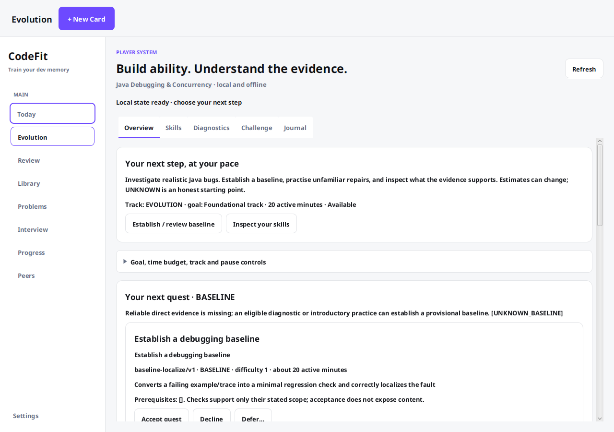
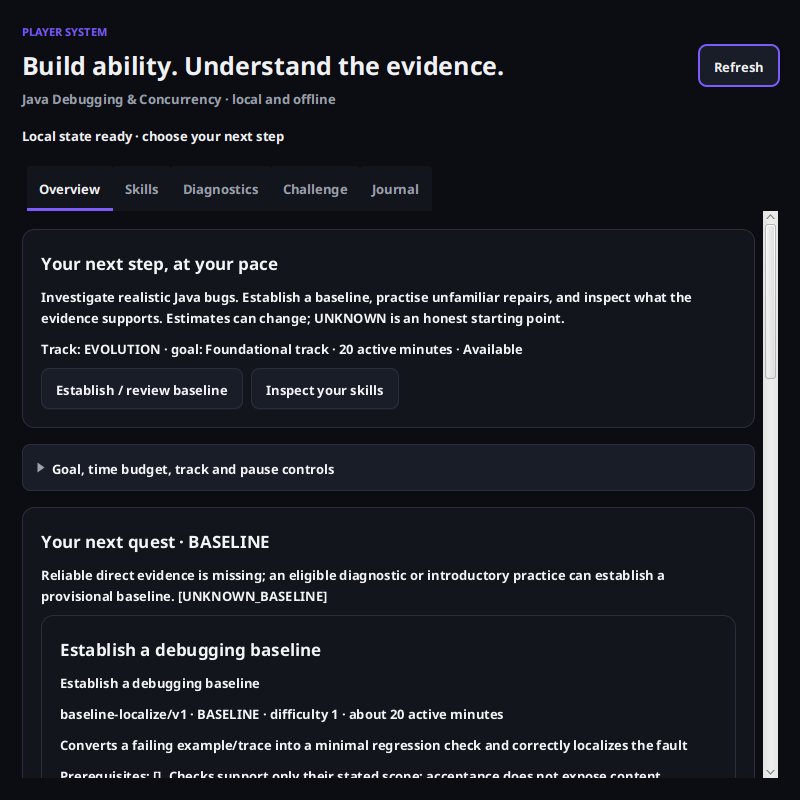

# EV-08 verification and desktop smoke test

This documents implementation checks for [#216](https://github.com/MrH3lmy/CodeFit/issues/216).
No learner database is used. Database tests use temporary SQLite files and the existing root-database
fingerprint guard. Reference solutions are author fixtures, not evidence about a human learner.

## Acceptance coverage

| Requirement | Evidence |
| --- | --- |
| Existing shell, themes and navigation | `EvolutionNavigationTest` exercises the real sidebar/scene and returns to ordinary Problems. Legacy Problems refresh workers are joined before restoring the isolated database URL, preventing a late default-path read. `FxmlLoadingTest` loads every route and disposes the asynchronous Evolution route before database teardown. |
| First-time offline entry and exact four UNKNOWN skills | `EvolutionControllerTest` loads actual FXML, real SQLite services and CSS. Service construction asserts it is off FX. No account, peer or network service is required. |
| Onboarding/goals/budget, pause/defer/decline/re-enable | Typed `LearnerCommand` UI bindings; restart tests in `PlayerSystemServiceTest`; existing adaptation tests validate every command, conflict and current eligibility. Default budget remains 20. |
| Baseline and exposure before content | Actual FXML start/familiarity dialog and committed receipt checks, existing presentation transaction tests, safe fragment/harness exclusion assertions. |
| Draft/restart and source ownership | Actual editor save, controller recreation, receipt resume, exact source comparison and no second presentation. Keyed responses/reflection/help survive service recreation and repeated initialization. |
| Deliberate real Java evaluation | Actual Submit button → frozen coordinator → FINALIZED/PASSED → canonical evidence → displayed DEVELOPING → new stored recommendation. The fixture does not claim mastery. |
| Honest feedback and interrupted recovery | Redacted coordinator View only, per-check limitations and evidence metadata; PREPARED recovery/cancel/replay tests; existing evaluator adversarial/crash/mutant tests remain in the full suite. |
| No double submission / edited-draft substitution | Actual duplicate clicks and lost-response recovery after commit yield one durable command, even after new editor changes; service replay retains original source despite an updated draft and rejects changed payload under one ID. |
| Result saved independently of derivation | Actual controller test injects adaptation failure after evaluation. Saved result remains visible, pending message appears, retry refreshes without a second submission/evidence record. |
| Safe hints/assistance/familiarity | Existing exposure APIs and same-family context; actual hint record/idempotence plus assisted result integration confirms zero independent families. |
| Public practice creates no proof | Real packaged public cases pass without submission/attempt/evidence. Same practice-command replay returns NOT_RUN. New rehearsal fact postpones retention in `MasteryIntegrationTest` without adding evidence. Held-out practice is rejected. |
| Journal is read-only and traceable | Projection/purity tests; nanosecond timestamp ordering; equal-time hints; page/source watermarks exclude later backdated appends; no source/harness/answer copies in messages. Saved decision/revision lookup remains with its owner. |
| Background work, navigation and stale responses | Actual controller navigation waits for unsaved edits to persist; disposed route ignores a deliberately delayed worker response. Queue is bounded; compilation/evaluation/cancellation stay off FX. |
| Recoverable errors and redaction | `PlayerErrorPresentationTest` verifies busy database, paused diagnostic, unknown failure and historical interpreter messages never echo private diagnostics. |
| Migration and learner history | `PlayerWorkspaceMigrationTest` compares every pre-existing table before/after populated v18 → v19 and repeated startup; forced notes failure rolls back the original Java draft too. Existing historical migration snapshots retain their original-row assertions. |
| Existing learning and P2P | Full suite includes workbook/curriculum, sessions/drafts, assessments, flashcards, guidance, evaluator/evidence/mastery/adaptation, peers and signatures. `EvolutionPeerPrivacyTest` now adds Player Java/keyed drafts, reflection, rehearsal and journal reads to its byte-identical signed payload/ordinary aggregate checks. |

## Commands and results

Java: OpenJDK 21.0.12.1; Maven 3.9.11; JavaFX 21.0.5; Linux amd64.
An actual Xvfb X11 server was used (`1440x1000x24`), not a mocked toolkit. CI runs Maven through
`xvfb-run -a` so the existing GUI test classes execute there too. Without a display, existing toolkit
assumptions skip display-dependent classes; service tests alone must not be reported as UI proof.

```bash
# Focused integration, real FXML, migrations and privacy:
DISPLAY=:99 mvn -B \
  -Dtest=EvolutionNavigationTest,EvolutionControllerTest,PlayerSystemServiceTest,EvolutionJournalTest,PlayerWorkspaceMigrationTest,MasteryIntegrationTest,EvolutionPeerPrivacyTest,FxmlLoadingTest,*MigrationTest \
  test

# Full Java 21 suite, including real GUI tests:
DISPLAY=:99 mvn -B clean test
# CI / a desktop runner with xvfb-run:
xvfb-run -a mvn -B test

# Optional screenshots from actual FXML/scene tests, using generated fixture state only:
DISPLAY=:99 mvn -B -Dtest=EvolutionControllerTest,EvolutionNavigationTest \
  -Dcodefit.visualDir=/tmp/codefit-evolution-visual test
```

The final focused integration run completed **74 tests, 0 failures/errors/skips** in 1m26s,
with `TZ=Pacific/Honolulu`, including all eight actual controller tests and safe-error presentation.
The complete rendered Java 21 `clean test` run completed **1,716 tests, 0 failures/errors/skips**
in **7m47s**, with no default `codefit.db` created and no escaped Problems refresh worker.
The final post-disclosure FXML/controller/navigation/error check completed **15 tests,
0 failures/errors/skips** in 32.7s and verifies the visible runner notice before execution.
GitHub CI results for the exact commit are recorded in the pull request after verification.

## Rendered visual verification

These images are actual JavaFX snapshots from isolated fresh test databases. They contain only safe
pre-presentation metadata, no reserved prompt, reference solution, source code or learner information.
The shell is 1280×900; the dark content view was resized to approximately 800×800. Tests assert the
narrow root width actually changed before taking the image.





The rendered checks exercised FXML loading, light/dark theme tokens, wrapped labels, scrolling,
control placement, sidebar selection and navigation. Automated interaction covered familiarity,
draft editing/save/re-entry, deliberate evaluation, result rendering, retry after derivation failure,
separate acceptance/start and journal access. This is not a claim of a human screen-reader audit or
Windows/macOS desktop validation.

## Reproducible human desktop walkthrough

Use a **throwaway checkout** with no `codefit.db`, not a real learner working directory. For example,
clone the review branch to a temporary directory, enter that checkout and run `mvn javafx:run` with
Java 21. Disconnect networking to verify offline operation. Do not delete a real database to prepare
the smoke test. The following manual checklist is supplied for reviewer validation; automated tests
and rendered screenshots above are the executed evidence for this environment.

1. Open Evolution in the sidebar. Confirm all four exact skills are UNKNOWN and ordinary destinations
   remain accessible. Open Skills and inspect the missing evidence explanations.
2. Expand direction controls. Choose a goal and 30/40/50 active minutes explicitly. Pause/resume,
   switch to ordinary curriculum, then switch back. No XP/skill penalty should occur.
3. Enter Diagnostics. Start a task, select an honest familiarity declaration, and verify its prompt
   appears only after authorization. Skip one task, skip all, resume, and inspect retained results.
4. Open the Java diagnostic. Edit only `Exercise`; the trusted Main must not be shown. Enter reflection
   and outside-help facts. Save, navigate away, return, close/restart and resume the same draft.
5. Run public practice. It must say no evidence was recorded. Reveal a hint/reference only through its
   button, observe the exposure warning, then deliberately submit a valid repair. Confirm a saved
   result, check limitations, assistance/exposure and the actual skill estimate. An assisted pass must
   not be presented as independent mastery.
6. Try invalid source, an incorrect repair and cancellation. Inspect real outcome vocabulary rather
   than a generic failed-skill score. To simulate interruption, prepare a submission in an isolated
   fixture; resume the existing command from its recovery link. Do not manufacture a new command to
   recover an old operation.
7. Accept the next offered quest. Confirm acceptance alone reveals no prompt. Start separately. If
   the finite pack cannot satisfy prerequisites/difficulty/budget, inspect exclusions; use explicitly
   permitted exploratory PRACTICE, change direction/budget, or rest. Held-outs must not become practice.
8. Defer/decline a candidate, restart, and confirm its state remains. Re-enable through the direction
   controls. Verify a paused track does not force a recommendation.
9. Open Journal and page older events. Inspect a saved decision, estimate, evidence source and result.
   Continue an existing authorized receipt. Generic Problems/workspace/search must still exclude
   reserved content, including when its numeric Problem ID is known.
10. Use keyboard navigation (including Tab/Shift-Tab out of editors), light/dark themes and a narrower
    window. Check readability/focus. Exercise ordinary review, curriculum, guided study, weekly
    assessment and opted-in peer summaries without new Evolution details appearing in them.

## Adversarial review and remaining limits

Reviewed reserved-route bypasses, trusted-harness concealment, check-feedback redaction, frozen
submission identity, uncertain retry payloads, same-connection draft atomicity, source-linked journal
pagination, pre-execution rehearsal, retention quiet periods, cancellation-before-prepare, stale worker
callbacks, navigation save failure and signed peer aggregates. No grading policy or XP path was added.

Safe limits remain: local declarations are not proctoring; installed assets are inspectable; the runner
is not a sandbox; hard crashes can lose unsaved debounced edits; journal/estimation/adaptation inputs
have explicit bounds; and unsupported historical interpreters fail closed. #228–#230 and
#232/#233/#235/#236 remain deferred. New future tracks/graph versions need a reviewed UI adapter.
No learner-improvement, platform portability or accessibility certification is claimed.
